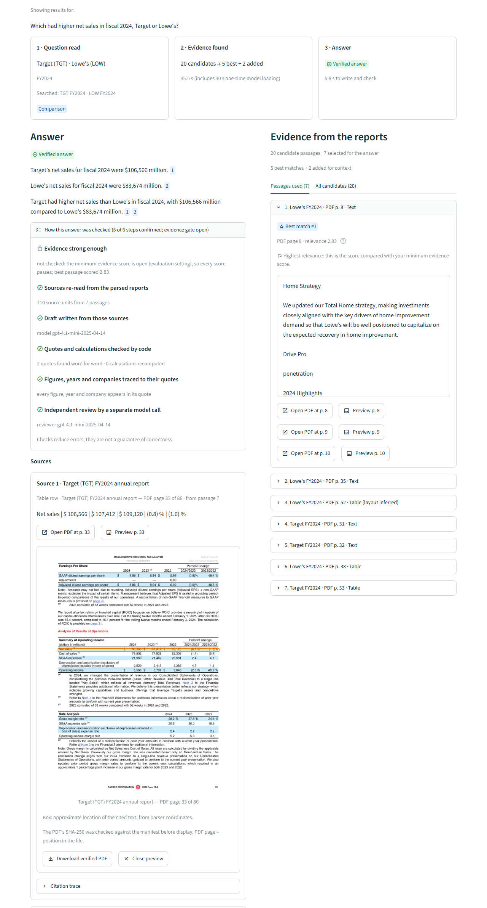
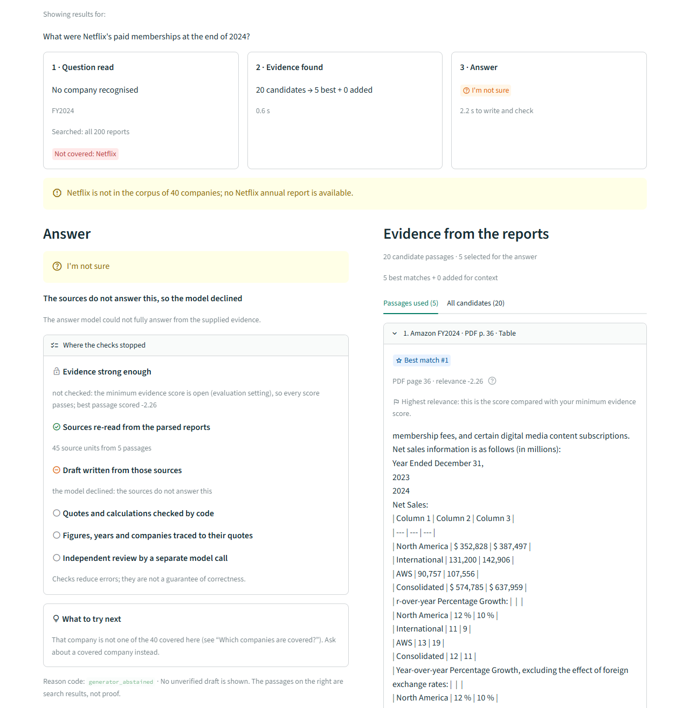

# Financial Report QA

Question answering over 200 annual reports from 40 US companies, FY2021–FY2025. Every released answer cites PDF pages, and each quote behind it is matched exactly against the parsed source. When a check fails, the system replies **"I'm not sure"** with a machine-readable reason code instead of returning an unverified draft. The repository contains the full pipeline, from PDF download to a local Streamlit demo, and the experiments behind its main design choices.

In one paragraph: a scope resolver reads which companies and fiscal years a question is about. Exact BGE-M3 vector search runs over those companies' reports only. A BGE cross-encoder re-ranks the candidates into a balanced Top-5, and tables and passages that the re-ranker tends to drop are added after it. An LLM then drafts short claims, each backed by a verbatim quote. Code checks every quote, number, year, company and calculation against the source, and a second model call reviews the result. Anything unproven becomes a refusal with its reason.


<table>
<tr>
<td width="55%"></td>
<td width="45%"></td>
</tr>
<tr>
<td>A verified answer: every claim cites a quote, five checks are confirmed (the evidence-score gate is open, as in the evaluations), and the preview highlights the cited row on the PDF page.</td>
<td>A refusal: Netflix is not in the corpus, so the model declines and the page says where the checks stopped and what to try next.</td>
</tr>
</table>

## Results

**The shipped system** (corpus v2, prompt `evidence-bound-claims-v2.3`, gpt-4.1-mini as generator and reviewer, confidence gate open). It was measured on a frozen 100-question benchmark (50 dev and 50 test questions, no company shared between the splits) and on a 50-question live usage pool:

| Questions | Result | Table |
|---|---|---|
| Factual, 40 × 5 repeats | 96.0% fully correct, 0.0% wrong, 4.0% refused | [A14](docs/system_architecture.md#a14-corpus-v2-parser-header-order-fix-separate-versioned-rebuild) |
| Comparative, 30 × 5 repeats | 68.0% fully correct, 2.7% wrong, 28.7% refused | [A14](docs/system_architecture.md#a14-corpus-v2-parser-header-order-fix-separate-versioned-rebuild) |
| Summary, 30 × 2 repeats, blind-graded | 51.7% fully correct, 5.0% wrong, 20.0% refused (graded on corpus v1; the 30 summary contexts are identical on v2) | [A13](docs/system_architecture.md#a13-next-phase-directions-comparison-verdict-value-checks-citation-repair-context-extras-v3), [A14](docs/system_architecture.md#a14-corpus-v2-parser-header-order-fix-separate-versioned-rebuild) |
| Live usage pool, 50 questions, one run | 35 good outcomes, 1 wrong answer (three single runs of this answer stage scored 31–35) | [A14](docs/system_architecture.md#a14-corpus-v2-parser-header-order-fix-separate-versioned-rebuild) |
| Evidence recall of the context the answer model receives | 85.2% (strict judge), about 4,180 tokens per question; identical on v1 and v2 | [A14](docs/system_architecture.md#a14-corpus-v2-parser-header-order-fix-separate-versioned-rebuild) |

A good outcome is a correct answer, an acceptable clarification or a correct refusal. The benchmark and live questions were also used to design the later fixes (see [Evaluation](#evaluation)), so these rates are in-sample, and labels and grades were written by AI agents without human review.

**How each design choice was measured,** in pipeline order. Arrows run from the earlier pipeline to the later one; in the decomposition row the arrow runs from the default scoped path to the opt-in decomposition.

| Change | Result | Table |
|---|---|---|
| Re-ranking and company-scoped pools, 50 test questions | Evidence Recall@5 37.33% vector → 48.00% reranked → 51.33% scoped (the scoping step is within noise) | [A7](docs/system_architecture.md#a7-re-ranking-vector-top-5-vs-vector-top-20--bge-reranker--top-5), [A6](docs/system_architecture.md#a6-retrieval--re-ranking-global-vs-scoped-pools-frozen-benchmark-same-reranker) |
| Live bad-case fixes, 50 live questions: good / wrong / unsafe | 17 / 5 / 1 → 32 / 1 / 0 | [A9](docs/system_architecture.md#a9-end-to-end-live-usage-pool-before-and-after-the-bad-case-fixes) |
| End-to-end answers, 100 benchmark questions | 34% → 51% correct overall; test split 32% → 48% | [A10](docs/system_architecture.md#a10-end-to-end-answers-on-the-frozen-100-question-benchmark-original-vs-current-pipeline) |
| Comparison decomposition, 30 comparative questions | Evidence Recall@5 31.67% → 53.33% (rule rewrite); no clear answer-accuracy gain, so off by default | [A11](docs/system_architecture.md#a11-comparison-decomposition-per-company-sub-questions-30-comparative-benchmark-questions-12-live-comparisons) |
| Context extras after the Top-5 | Delivered-context recall 57.5% → 75.8%; benchmark accuracy 50% → 64%, wrong 8 → 3; live good 32 → 34 (not significant), wrong 2 → 3 | [A12](docs/system_architecture.md#a12-context-extras-passages-appended-after-the-reranked-top-5-benchmark-and-live-pool) |
| Next-phase directions, 100 questions × 5 repeats | Fully correct on factual + comparative +10.2 of 70 (CI +5.2 to +15.8); comparisons 36.7% → 66.0%; context recall 75.8% → 85.2%; summaries 41.7% → 51.7% fully correct; live pool unchanged (34 of 50) | [A13](docs/system_architecture.md#a13-next-phase-directions-comparison-verdict-value-checks-citation-repair-context-extras-v3) |
| Corpus v2: table headers re-parsed in column order | 108 tables fixed, none broken; dev-017 refused → correct 5 of 5; no gold unit lost; fully correct +0.4 of 70 (CI −1.8 to +3.2) | [A14](docs/system_architecture.md#a14-corpus-v2-parser-header-order-fix-separate-versioned-rebuild) |

## Pipeline


The full diagram, the request path in code and the reasons for each module are in [docs/system_architecture.md](docs/system_architecture.md).

## How it works

1. **Segmentation.** PyMuPDF extracts native text and pdfplumber extracts tables. The parser uses transparent geometric layout heuristics rather than a neural layout stack, and every paragraph and table keeps its PDF page and bounding box. A numeric-integrity gate keeps a table as structured rows only when its digits match the native text: 12,055 of 13,141 tables pass, and the other 1,086 fall back to the original text. Chunks are 512 tokens with a 50-token overlap and never split a table row. In a 40-question BM25 pilot, this setting had the highest Evidence Recall@5 of the nine variants (50.00%) and the smallest Top-5 context ([A1](docs/system_architecture.md#a1-segmentation-chunk-size--overlap-bm25-40-question-pilot-48-gold-units)).
2. **Indexing.** Chunks are embedded with BGE-M3 (1,024 dimensions, 8,192-token limit) into an exact FAISS `IndexFlatIP`. SQLite FTS5 stores chunk payloads and citations. BGE-M3 embeds all 56,525 chunks without truncation, whereas bge-large-en-v1.5 would have to truncate 14,704 of them (26.01%) ([A2](docs/system_architecture.md#a2-indexing-embedding-model-feasibility-all-56525-rendered-chunks)). Exact search takes about 22 ms per query (median, CPU) and, unlike the approximate indexes, supports exact per-company filtered search ([A3](docs/system_architecture.md#a3-indexing-faiss-index-type-50-test-questions-cpu-4-threads)).
3. **Retrieval.** A scope resolver maps company names, aliases, tickers, typos and Chinese names to the corpus. It also resolves explicit years, relative periods such as "last year", and questions with no period. Each resolved company then gets its own exact vector search. Dense search outperformed BM25 (37.33% vs 11.33% test Evidence Recall@5), and hybrid fusion did not beat dense search at depth 20, the reranker's standard candidate depth ([A4](docs/system_architecture.md#a4-retrieval-dense-vs-bm25-vs-weighted-hybrid-frozen-benchmark)). Scoping fixes which reports are searched: Document Recall@5 reached 100% on both splits ([A6](docs/system_architecture.md#a6-retrieval--re-ranking-global-vs-scoped-pools-frozen-benchmark-same-reranker)).
4. **Re-ranking.** The BGE reranker v2-m3 cross-encoder scores every pooled candidate at full length and refuses to truncate. It then selects a balanced Top-5: slots reserved for each compared company, near-duplicates from a company's other reports skipped, and latest-report slots for undated questions. Because the reranker demotes statement tables, context extras are then appended (up to 8, or 10 for a summary): the best row-label table per company, BM25 hits for a single company's question or for each theme of its summary question, the neighbouring prose of a summary's selected passages, and the continuation of a split table.
5. **Generation.** A fail-closed confidence gate runs first. Source binding then re-derives every passage from the parsed source. The generator returns individually checkable claims, each carrying verbatim quotes, and the application recomputes any derived value. Deterministic checks follow:
   - citation repair re-points a quote to an exact source span;
   - every quote must match its source exactly;
   - every year, number and company in a claim must appear in the cited text, a figure must come from its own fiscal year's column, and qualifiers such as non-GAAP or organic must stay with the cited figure.

   A separate verifier call then judges support and completeness. Page numbers come from verified metadata, never from the model ([generation constraints](docs/generation_constraints.md)).
6. **Evaluation.** Three methods cover different blind spots ([§2.6](docs/system_architecture.md#26-evaluation-three-complementary-evidence-sources)):
   - a frozen benchmark measures source selection and, when answers are graded, end-to-end accuracy;
   - a live usage pool measures the product path end to end;
   - controlled fixtures confirm that each safety branch refuses injected faults.

The Streamlit demo and the live evaluation runner share one request path, `DemoService`.

## Quickstart

**Fastest look: the test suite.** It needs no data, models or API key, but it does install PyTorch.

```bash
git clone https://github.com/GoBackwards/finance_qa_system.git
cd finance_qa_system
python -m venv .venv
source .venv/bin/activate          # Windows: .venv\Scripts\activate
pip install -e ".[corpus,experiments,vectors,demo]"
python -m unittest discover -s tests
```

Python 3.11+ is required. For GPU inference, install the CUDA build of PyTorch first ([vector index setup](docs/vector_index.md#installation-and-execution)).

**Build the demo corpus.** The repository commits code, the report inventory ([`data/manifest.json`](data/manifest.json), with source URLs, page counts and SHA-256), benchmark labels and compact result records. PDFs, parsed output, chunks, indexes and model weights are gitignored. Three commands build them:

```bash
# Download and verify the 200 PDFs (also needs Poppler's pdfinfo)
python scripts/collect_reports.py --only-missing --workers 4
python scripts/verify_corpus.py
# Parse, audit, chunk, build the chunk store and the BGE-M3 index, and fetch the reranker
python scripts/build_corpus.py --device cuda:0
```

`build_corpus.py` writes corpus v2 into its own folders (`CORPORA` in [`demo_service.py`](src/report_search/demo_service.py)), and an interrupted build resumes when the command is run again (parsing, chunking and embedding resume; the chunk store and index are rebuilt in a few minutes on every run, so stop the demo before rerunning it). Corpus v2 and the two model snapshots take about 10 GB of disk, plus the Python environment (several GB with CUDA PyTorch). On an RTX 4060 laptop GPU the embedding stage took about 20 minutes; add `--gpu-memory-fraction 0.9` on an 8 GB GPU, and expect much longer on CPU (`--device cpu`).

**Run the demo.**

```bash
python -m streamlit run streamlit_app.py     # serves http://127.0.0.1:8501
```

Search works without a model endpoint. Set `FINANCE_QA_DEVICE=cuda:0` before launch to run on the GPU. To generate answers, you need an OpenAI-compatible Chat Completions endpoint with JSON mode. Configure it in the sidebar or the launch environment:

- `FINANCE_QA_BASE_URL` and `FINANCE_QA_MODEL` are required; `FINANCE_QA_API_KEY` is required only if the endpoint needs authentication. It stays on the server and is used only with `FINANCE_QA_BASE_URL`; an endpoint typed into the sidebar needs its own key.
- `FINANCE_QA_VERIFIER_MODEL`, `FINANCE_QA_TOKEN_PARAMETER` and `FINANCE_QA_DEADLINE_SECONDS` are optional.
- `FINANCE_QA_CORPUS` selects the corpus: `v2` (default) or `v1`.

[`.env.example`](.env.example) documents each variable. The app does not read `.env` files.

The answer threshold must also be set explicitly, through `FINANCE_QA_THRESHOLD` or the sidebar's minimum evidence score. While it is blank, every answer request abstains, and no default threshold is installed ([A8](docs/system_architecture.md#a8-generation-raw-reranker-logit-confidence-gate-dev-calibrated)). The evaluations ran with the gate open (`-1000000`), which leaves release decisions to the citation, grounding and verifier checks; it is an evaluation setting, not a calibrated threshold. See [docs/streamlit_demo.md](docs/streamlit_demo.md) for the details.

**Corpus versions.** Tables A1–A13 were measured on corpus v1, which was parsed before the table header-order fix and is kept read-only. Corpus v2, the default, is the same 200 reports parsed with that fix ([A14](docs/system_architecture.md#a14-corpus-v2-parser-header-order-fix-separate-versioned-rebuild)). This checkout's parser produces v2 only; rebuilding v1 needs the parser from commit `435b7ae`. The reproduction commands for Tables A6 and A9–A14 are in [system_architecture.md §4](docs/system_architecture.md#4-reproduce), and the per-stage documents cover A1–A5, A7 and A8. `scripts/run_live_usage.py` reads the model settings and deadline from the environment or from a local `.env` file, and takes the threshold, device and corpus as flags.

## Repository layout

```text
src/
  report_parser/      PDF to page-grounded text, tables and citations
  report_chunker/     table-preserving chunking, chunk validation, BM25 pilot
  report_index/       BGE-M3 embeddings, FAISS index build and comparison
  report_search/      query scope, scoped retrieval, reranking, confidence gate, evidence
                      binding, generation, answer verification, DemoService, demo wording
scripts/              command-line entry points for every stage, experiment and live run
streamlit_app.py      local demo
tests/                unittest suite
data/
  manifest.json       report inventory with source URLs, page counts and SHA-256
  evaluation/         benchmark labels, live questions, grades and result records
docs/                 architecture hub, per-stage write-ups, bad-case audits and screenshots
```

## Evaluation

| Evaluation | Measures | Cannot measure |
|---|---|---|
| Frozen benchmark: 100 questions (40 factual, 30 comparative, 30 summary), 190 source-anchored evidence units, no company shared between dev and test | Source selection (Evidence Recall@K, complete evidence) and, when answers are graded, end-to-end accuracy | Production accuracy; the labels are non-exhaustive |
| Live usage pool: 50 realistic questions from four user personas, run through the demo path | End-to-end behaviour, including the stage where each failure occurs | Production rates, because the questions were designed |
| Controlled fixtures | That each safety branch refuses injected faults with the expected reason code | How often real models make errors |

Read the results with these caveats:

- **No human review.** Benchmark labels and live gold answers were written by agents and checked against the sources. Grades were also written by agents, and a second agent re-checked every grade adversarially. No person has independently reviewed any of them.
- **In-sample fixes.** The live fixes (A9) were designed on the live questions, and the A12–A13 rules after diagnosing failures on the same benchmark and live questions. Their gains show that the fixes work on those cases, not that they generalise. The benchmark answer comparison (A10) was not used to design the live fixes.
- **Source selection is not answer accuracy.** Evidence Recall@K measures whether labelled passages reach the Top-K. On test, scoping's +3.33 points over re-ranking alone (CI −4.00 to +10.67) are within noise.
- **More answers, not fewer wrong answers (A10).** On the benchmark, wrong answers did not fall (8 → 9), because 21 more questions received an answer; the later context extras and value checks then brought wrong answers down.
- **Few repeats.** Tables A9–A12 ran each end-to-end configuration once, so gpt-4.1-mini sampling adds noise. A13 and A14 replay factual and comparative answers 5 times and the live pool once; A13 also grades summaries over 2 repeats. The gate was open so that every stage could be observed. Bootstrap intervals ignore dependence between questions that share a company or template.
- **Post-hoc prompt.** Prompt v2.2 was written after seeing the v2.1 grades on the comparative questions. The only pre-registered decomposition result is the rule-decomposition retrieval comparison.

## Project status

**Complete.** Every stage, from PDF download to cited answer, is implemented and runs on one machine; answer generation also needs an OpenAI-compatible model endpoint. The Streamlit demo shows how the question was read, why each passage was selected, the checks each answer passed, and each cited PDF page with the quoted row highlighted. The main design choices are backed by recorded comparisons (Tables A1–A14); each table names its result file, most of them in [`data/evaluation/`](data/evaluation).

**Open problems.**
- **Refusals on the live pool.** 15 of 50 live questions still fail in the latest run: 12 false refusals, 2 partially correct answers and 1 wrong answer ([A14](docs/system_architecture.md#a14-corpus-v2-parser-header-order-fix-separate-versioned-rebuild)).
- **Comparisons and summaries remain the weakest categories.** Comparisons reach 68.0% fully correct and summaries 51.7% (graded on corpus v1, A13), against 96.0% for factual questions. Most remaining comparison failures are refusals (28.7% of replays).
- **Column and segment errors.** A figure taken from another fiscal year's column of a structured table row is caught and refused. Figures cited from loose text fragments carry no column year, so the check cannot catch them (test-028 was wrong in 17 of 20 answer-side replays before the v3 contexts fixed it). A segment table taken as the company total is not checked (dev-021, B12).
- **Token cost.** Context extras v3 roughly doubles summary context.
- **No OCR.** 324 pages carry sparse-text or encoding warnings.
- **No default confidence threshold.** Raw reranker logits are not calibrated probabilities. The dev-calibrated threshold (6.359375) would have kept only 4 of the 25 correct or acceptable live answers, so operators must choose a threshold.
- **No independent human review** of labels or grades.

**Next steps.**
- Confirm the A12–A14 gains on a fresh held-out question set, since their rules were designed on the benchmark and live failures.
- Reduce refusals on comparisons, and reduce summary context, for example by keeping only reranker-ranked neighbours.
- Add scoped BM25 candidates for lexical cues ("critical audit matter", credit ratings) and section typing for summary themes outside Item 1A ([recall roadmap](docs/recall_roadmap.md)).
- Add an OCR stage for flagged pages.
- Get human review of labels and grades.

## Documentation

**Start here**

| Document | Contents |
|---|---|
| [System architecture](docs/system_architecture.md) | Pipeline diagram, request path in code, module rationale, experiment Tables A1–A14, reproduction commands |
| [Streamlit demo](docs/streamlit_demo.md) | Running the demo, required local artifacts, configuration and the resource model |
| [Corpus](data/README.md) | Report collection, sources, fiscal-year naming and page-citation conventions |

**Pipeline stages**

| Document | Contents |
|---|---|
| [PDF parsing](docs/parsing.md) · [DeepDoc reference](docs/deepdoc_reference.md) | Parser commands, output format, parsing decisions, quality limits and the validated corpus run; design review of DeepDoc |
| [Chunking experiment](docs/chunking_experiment.md) · [chunking pilot benchmark](docs/chunking_benchmark.md) | Table-preserving chunker and the size/overlap comparison (A1) |
| [Vector index](docs/vector_index.md) · [FAISS comparison](docs/faiss_index_comparison.md) | BGE-M3 embedding, token-length preflight, Flat/IVF/HNSW measurements (A2, A3) |
| [Retrieval experiment](docs/retrieval_experiment.md) · [retrieval comparison](docs/retrieval_comparison.md) · [Recall@K sweep](docs/recall_at_k_comparison.md) | Benchmark design and the dense, BM25 and hybrid comparison (A4) |
| [Reranker](docs/reranker.md) · [reranker comparison](docs/reranker_comparison.md) | Cross-encoder integration and the vector vs reranked Top-5 comparison (A7) |
| [Generation constraints](docs/generation_constraints.md) | Evidence-bound claims, citation checks, the verifier and the confidence-gate diagnostic (A8) |

**Evaluation and failure analysis**

| Document | Contents |
|---|---|
| [Live bad cases](docs/live_bad_cases.md) | Live audit: failure types, root causes, mitigations and before/after results (A9) |
| [Classic bad cases](docs/classic_bad_cases.md) | Earlier controlled audit: retrieval probes, injected generation faults and provider defects |
| [Failure handling](docs/failure_handling.md) | Failure taxonomy and the query-expansion ablation (A5) |
| [Recall roadmap](docs/recall_roadmap.md) | Where recall is lost (pool vs reranking), ranked improvement directions and what not to do; its quick wins became the context extras (A12) |
| [Next-phase plan](docs/next_phase_plan.md) | Residual failures after the context extras and the ranked directions; implemented and measured in A13 and A14 |

## License and acknowledgements

The code is released under the [MIT License](LICENSE). It depends on [PyMuPDF](https://pymupdf.readthedocs.io/), which is licensed under AGPL-3.0 (or a commercial license from Artifex). Distributing software that bundles PyMuPDF is subject to PyMuPDF's own terms. Other main dependencies are pdfplumber, FAISS, FlagEmbedding, PyTorch, Transformers and Streamlit.

The pipeline uses the pinned models [BAAI/bge-m3](https://huggingface.co/BAAI/bge-m3) and [BAAI/bge-reranker-v2-m3](https://huggingface.co/BAAI/bge-reranker-v2-m3); see their model cards for their license terms. Answers in the evaluations were generated with OpenAI's gpt-4.1-mini.

The annual reports belong to their issuers. The repository stores their source URLs, hashes and metadata ([`data/manifest.json`](data/manifest.json), including the first ~2,500 characters of each report's extracted text, kept for manual inspection), and short evidence quotes in the benchmark labels and grades. The collector downloads the PDFs from issuer, SEC-hosted or public-mirror sources ([data/README.md](data/README.md)).
