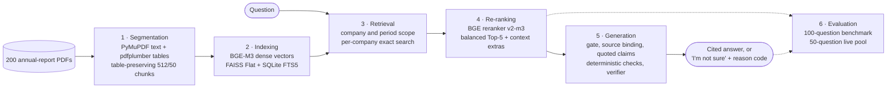

# Financial Report QA

Question answering over 200 annual reports from 40 US companies, FY2021–FY2025. Every released answer cites PDF pages, and each quote behind it is matched exactly against the parsed source. When a check fails, the system replies **"I'm not sure"** with a machine-readable reason code instead of returning an unverified draft. The repository contains the full pipeline, from PDF download to a local Streamlit demo, and the experiments behind its main design choices.

## Results at a glance

The system was measured on a frozen 100-question benchmark (50 dev and 50 test questions, with no company shared between splits) and on a 50-question live usage pool. Answers were generated and verified with gpt-4.1-mini; the current-pipeline answer runs (A9, A10) used prompt v2.1; v2.2 adds a verdict rule for comparisons (A11), and the shipped v2.3 adds a verifier calibration sentence (A13). Arrows run from the earlier pipeline to the current one; in the decomposition row the arrow runs from the default scoped path to the opt-in decomposition.

| Measure | Result | Table |
|---|---|---|
| Evidence Recall@5, 50 test questions | 37.33% vector → 48.00% reranked → 51.33% scoped (the scoping step is within noise) | [A7](docs/system_architecture.md#a7-re-ranking-vector-top-5-vs-vector-top-20--bge-reranker--top-5), [A6](docs/system_architecture.md#a6-retrieval--re-ranking-global-vs-scoped-pools-frozen-benchmark-same-reranker) |
| End-to-end answer accuracy, 100 benchmark questions | 34% → 51% overall; test split 32% → 48% | [A10](docs/system_architecture.md#a10-end-to-end-answers-on-the-frozen-100-question-benchmark-original-vs-current-pipeline) |
| Live usage pool, 50 questions: good / wrong / unsafe | 17 / 5 / 1 → 32 / 1 / 0 | [A9](docs/system_architecture.md#a9-end-to-end-live-usage-pool-before-and-after-the-bad-case-fixes) |
| Context extras after the Top-5, 100 benchmark and 50 live questions | Evidence Recall of the delivered context 57.5% (5 passages) → 75.8% (7.6 on average); answer accuracy 50% → 64% (test 44% → 56%), wrong answers 8 → 3; live pool good outcomes 32 → 34 (not significant), wrong 2 → 3 | [A12](docs/system_architecture.md#a12-context-extras-passages-appended-after-the-reranked-top-5-benchmark-and-live-pool) |
| Next-phase directions, 100 benchmark questions × 5 repeats | Fully correct on factual + comparative +10.2 of 70 (CI +5.2 to +15.8); comparisons 36.7% → 66.0%; final-context recall 75.8% → 85.2%; summaries fully correct 41.7% → 51.7%; live pool unchanged (34 good of 50) | [A13](docs/system_architecture.md#a13-next-phase-directions-comparison-verdict-value-checks-citation-repair-context-extras-v3) |
| Comparison decomposition, 30 comparative questions | Evidence Recall@5 31.67% → 53.33% (rule rewrite); no clear answer-accuracy gain, so off by default | [A11](docs/system_architecture.md#a11-comparison-decomposition-per-company-sub-questions-30-comparative-benchmark-questions-12-live-comparisons) |

A good outcome is a correct answer, an acceptable clarification or a correct refusal. The caveats in [Evaluation](#evaluation) apply to every row.

## Pipeline



The full diagram, the request path in code and the reasons for each module are in [docs/system_architecture.md](docs/system_architecture.md).

## How it works

1. **Segmentation.** PyMuPDF extracts native text and pdfplumber extracts tables. The parser uses transparent geometric layout heuristics rather than a neural layout stack, and every paragraph and table keeps its PDF page and bounding box. A numeric-integrity gate keeps a table as structured rows only when its digits match the native text: 12,055 of 13,141 tables pass, and the other 1,086 fall back to the original text. Chunks are 512 tokens with a 50-token overlap and never split a table row. In a 40-question BM25 pilot, this setting had the highest Evidence Recall@5 of the nine variants (50.00%) and the smallest Top-5 context ([A1](docs/system_architecture.md#a1-segmentation-chunk-size--overlap-bm25-40-question-pilot-48-gold-units)).
2. **Indexing.** Chunks are embedded with BGE-M3 (1,024 dimensions, 8,192-token limit) into an exact FAISS `IndexFlatIP`. SQLite FTS5 stores chunk payloads and citations. BGE-M3 embeds all 56,525 chunks without truncation, whereas bge-large-en-v1.5 would have to truncate 14,704 of them (26.01%) ([A2](docs/system_architecture.md#a2-indexing-embedding-model-feasibility-all-56525-rendered-chunks)). Exact search takes about 22 ms per query (median, CPU) and, unlike the approximate indexes, supports exact per-company filtered search ([A3](docs/system_architecture.md#a3-indexing-faiss-index-type-50-test-questions-cpu-4-threads)).
3. **Retrieval.** A scope resolver maps company names, aliases, tickers, typos and Chinese names to the corpus. It also resolves explicit years, relative periods such as "last year", and questions with no period. Each resolved company then gets its own exact vector search. Dense search outperformed BM25 (37.33% vs 11.33% test Evidence Recall@5), and hybrid fusion did not beat dense search at depth 20, the reranker's standard candidate depth ([A4](docs/system_architecture.md#a4-retrieval-dense-vs-bm25-vs-weighted-hybrid-frozen-benchmark)). Scoping fixes which reports are searched: Document Recall@5 reached 100% on both splits ([A6](docs/system_architecture.md#a6-retrieval--re-ranking-global-vs-scoped-pools-frozen-benchmark-same-reranker)).
4. **Re-ranking.** The BGE reranker v2-m3 cross-encoder scores every pooled candidate at full length and refuses to truncate. It then selects a balanced Top-5: slots reserved for each compared company, near-duplicates from a company's other reports skipped, and latest-report slots for undated questions. Re-ranking added 10.67 points of test Evidence Recall@5 at a median cost of 388.8 ms of GPU scoring per query ([A7](docs/system_architecture.md#a7-re-ranking-vector-top-5-vs-vector-top-20--bge-reranker--top-5)). Because the reranker demotes statement tables, context extras are then appended (up to 8, or 10 for a summary): the best row-label table per company, BM25 hits for a single company's question or for each theme of its summary question, the neighbouring prose of a summary's selected passages, and the continuation of a split table. The first version raised evidence recall of the delivered context from 57.5% to 75.8% and benchmark accuracy from 50% to 64% ([A12](docs/system_architecture.md#a12-context-extras-passages-appended-after-the-reranked-top-5-benchmark-and-live-pool)); the current version (v3) reaches 85.2% recall ([A13](docs/system_architecture.md#a13-next-phase-directions-comparison-verdict-value-checks-citation-repair-context-extras-v3)).
5. **Generation.** A fail-closed confidence gate runs first. Source binding then re-derives every passage from the parsed source. The generator returns individually checkable claims, each carrying verbatim quotes, and the application recomputes any derived value. Deterministic checks follow:
   - citation repair re-points a quote to an exact source span;
   - every quote must match its source exactly;
   - every year, number and company in a claim must appear in the cited text, and qualifiers such as non-GAAP or organic must stay with the cited figure.

   A separate verifier call then judges support and completeness. Page numbers come from verified metadata, never from the model ([generation constraints](docs/generation_constraints.md)).
6. **Evaluation.** Three methods cover different blind spots ([§2.6](docs/system_architecture.md#26-evaluation-three-complementary-evidence-sources)):
   - a frozen benchmark measures source selection;
   - a live usage pool measures the product path end to end;
   - controlled fixtures confirm that each safety branch refuses injected faults.

The Streamlit demo and the live evaluation runner share one request path, `DemoService`.

## Quickstart

Python 3.11+ is required. A CUDA GPU is optional; CPU inference is slower. Run the commands below from the repository root inside an activated virtual environment. The per-stage documents show the same commands in Windows PowerShell form.

```bash
python -m venv .venv
source .venv/bin/activate          # Windows: .venv\Scripts\activate
pip install -e ".[experiments,vectors,demo]"
```

For GPU inference, install the CUDA build of PyTorch first ([vector index setup](docs/vector_index.md#installation-and-execution)).

**Build the local data.** The repository commits code, the report inventory ([`data/manifest.json`](data/manifest.json), with source URLs, page counts and SHA-256), benchmark labels and compact result records. PDFs, parsed output, chunks, indexes and model weights are gitignored. Build them in this order:

```bash
# 1. Download and verify the PDFs (also needs pypdf, pypdfium2 and Poppler's pdfinfo)
python scripts/collect_reports.py --only-missing --workers 4
python scripts/verify_corpus.py

# 2. Parse into page-cited text and tables, then audit the output
python scripts/parse_reports.py --workers 4
python scripts/verify_parsed.py --source-manifest data/manifest.json

# 3. Chunk (writes all nine size/overlap variants; the pipeline uses 512/50)
python scripts/run_chunking_experiment.py --workers 4

# 4. Embed with the pinned BGE-M3 model and build the exact FAISS index
python scripts/build_vector_index.py --device cuda:0 --batch-size 8

# 5. Build the SQLite FTS5 chunk store and the frozen benchmark rankings
python scripts/run_retrieval_experiment.py --cutoffs 3 5 10 20 50 --output data/experiments/retrieval_k_sweep

# 6. Download the pinned reranker and score the benchmark candidates
python scripts/run_reranker_experiment.py
```

Without CUDA, pass `--device cpu` to steps 4–6. The reranker refuses to resume a checkpoint made with a different configuration, so give a CPU rerun its own output directory, such as `--output data/experiments/reranker_cpu`. Pinned model snapshots are cached under `.cache/huggingface/`, and the demo loads them from there without downloading. Steps 5 and 6 rerun the retrieval and reranker experiments; the demo needs the SQLite chunk store and reranker snapshot they leave behind. Parser options are covered in [docs/parsing.md](docs/parsing.md).

**Run the demo.**

```bash
python -m streamlit run streamlit_app.py     # serves http://127.0.0.1:8501
```

Search works without a model endpoint. Set `FINANCE_QA_DEVICE=cuda:0` before launch to run on the GPU. To generate answers, you need an OpenAI-compatible Chat Completions endpoint with JSON mode. Configure it in the sidebar or the launch environment:

- `FINANCE_QA_BASE_URL` and `FINANCE_QA_MODEL` are required; `FINANCE_QA_API_KEY` is required only if the endpoint needs authentication.
- `FINANCE_QA_VERIFIER_MODEL`, `FINANCE_QA_TOKEN_PARAMETER` and `FINANCE_QA_DEADLINE_SECONDS` are optional.

[`.env.example`](.env.example) documents each variable. The app does not read `.env` files.

The answer threshold must also be set explicitly, through `FINANCE_QA_THRESHOLD` or the sidebar's minimum evidence score. While it is blank, every answer request abstains, and no default threshold is installed ([A8](docs/system_architecture.md#a8-generation-raw-reranker-logit-confidence-gate-dev-calibrated)). The evaluations ran with the gate open (`-1000000`), which leaves release decisions to the citation, grounding and verifier checks. See [docs/streamlit_demo.md](docs/streamlit_demo.md) for the details.

**Run the tests.**

```bash
python -m unittest discover -s tests
```

The tests use temporary fixtures and stub models, so they need neither the built data nor a model endpoint. Reproduction commands for Tables A6 and A9–A11 are in [system_architecture.md §4](docs/system_architecture.md#4-reproduce); the per-stage documents cover A1–A5, A7 and A8. `scripts/run_live_usage.py` reads the model settings and deadline from the environment or from a local `.env` file, and takes the threshold and device as `--threshold` and `--device` flags.

## Repository layout

```text
src/
  report_parser/      PDF to page-grounded text, tables and citations
  report_chunker/     table-preserving chunking, chunk validation, BM25 pilot
  report_index/       BGE-M3 embeddings, FAISS index build and comparison
  report_search/      query scope, scoped retrieval, reranking, confidence gate, evidence
                      binding, generation, answer verification, DemoService
scripts/              command-line entry points for every stage, experiment and live run
streamlit_app.py      local demo
tests/                unittest suite
data/
  manifest.json       report inventory with source URLs, page counts and SHA-256
  evaluation/         benchmark labels, live questions, grades and result records
docs/                 architecture hub, per-stage write-ups and bad-case audits
```

## Evaluation

| Evaluation | Measures | Cannot measure |
|---|---|---|
| Frozen benchmark: 100 questions (40 factual, 30 comparative, 30 summary), 190 source-anchored evidence units, no company shared between dev and test | Source selection (Evidence Recall@K, complete evidence) and, when answers are graded, end-to-end accuracy (A10) | Production accuracy; the labels are non-exhaustive |
| Live usage pool: 50 realistic questions from four user personas, run through the demo path | End-to-end behaviour, including the stage where each failure occurs | Production rates, because the questions were designed |
| Controlled fixtures | That each safety branch refuses injected faults with the expected reason code | How often real models make errors |

Read the results with these caveats:

- **No human review.** Benchmark labels and live gold answers were written by agents and checked against the sources. Grades were also written by agents, and a second agent re-checked every grade adversarially. No person has independently reviewed any of them.
- **The live fixes were designed on the live questions.** The live pool's 17 → 32 good outcomes show that the fixes work on those cases, not that they generalise. The benchmark answer comparison (A10) was not used to design them.
- **Source selection is not answer accuracy.** Evidence Recall@K measures whether labelled passages reach the Top-K. On test, scoping's +3.33 points over re-ranking alone (CI −4.00 to +10.67) are within noise.
- **More answers, not fewer wrong answers.** On the benchmark, wrong answers did not fall (8 → 9), because 21 more questions now receive an answer.
- **Few repeats.** Tables A9–A12 ran each end-to-end configuration once, so gpt-4.1-mini sampling adds noise. A13 replays factual and comparative answers 5 times, summaries 2 times and the live pool once. The gate was open so that every stage could be observed. Bootstrap intervals ignore dependence between questions that share a company or template.
- **Post-hoc prompt.** Prompt v2.2 was written after seeing the v2.1 grades on the comparative questions. The only pre-registered decomposition result is the rule-decomposition retrieval comparison. Likewise, the A13 directions were designed after diagnosing failures on the same benchmark and live questions.

## Project status

**Complete.** Every stage, from PDF download to cited answer, is implemented and runs on one machine; answer generation also needs an OpenAI-compatible model endpoint. The Streamlit demo shows the interpreted scope, the selected passages and each cited PDF page. The main design choices are backed by recorded comparisons (Tables A1–A13); each table names its result file, most of them in [`data/evaluation/`](data/evaluation).

**Open problems.**
- **The live pool has not improved.** After the next-phase directions, 16 of 50 live questions still fail: 11 false refusals, 3 partially correct answers and 2 wrong answers. Good outcomes stayed at 34 ([A13](docs/system_architecture.md#a13-next-phase-directions-comparison-verdict-value-checks-citation-repair-context-extras-v3)).
- **Comparisons and summaries remain the weakest categories.** Comparisons reached 66.0% fully correct across 5 replays and summaries 51.7%, against 94.0% for factual questions. Most remaining comparison failures are refusals (30.7% of replays).
- **Column and segment errors.** A wrong fiscal-year column in a structured table row is now caught and refused, not fixed: dev-017 is refused 5 of 5 times instead of answered wrongly. Figures cited from loose text fragments carry no column year, so the check cannot catch test-028: it was wrong in 17 of 20 answer-side replays, and correct 5 of 5 times only with the fresh v3 contexts. A segment table taken as the company total is not checked (dev-021, B12).
- **Parser header order.** Same-line year headers can be printed in reverse order in table captions. The parser fix is written and tested, and is being built as a separate corpus version.
- **Token cost.** Context extras v3 roughly doubles summary context.
- **No OCR.** 324 pages carry sparse-text or encoding warnings.
- **No default confidence threshold.** Raw reranker logits are not calibrated probabilities. The dev-calibrated threshold (6.359375) would have kept only 4 of the 25 correct or acceptable live answers, so operators must choose a threshold.
- **No independent human review** of labels or grades.

**Next steps.**
- Measure the parser header-order fix on its separate corpus version.
- Confirm the A12 and A13 gains on a fresh held-out question set, since their rules were designed on the benchmark and live failures.
- Reduce summary context, for example by keeping only reranker-ranked neighbours, and reduce refusals on comparisons.
- Add scoped BM25 candidates for lexical cues ("critical audit matter", credit ratings) and section typing for summary themes outside Item 1A ([recall roadmap](docs/recall_roadmap.md)).
- Add an OCR stage for flagged pages.
- Get human review of labels and grades.

## Documentation

| Document | Contents |
|---|---|
| [System architecture](docs/system_architecture.md) | Start here: pipeline diagram, request path in code, module rationale, experiment Tables A1–A13, reproduction commands |
| [Corpus](data/README.md) | Report collection, sources, fiscal-year naming and page-citation conventions |
| [PDF parsing](docs/parsing.md) · [DeepDoc reference](docs/deepdoc_reference.md) | Parser commands, output format, parsing decisions, quality limits and the validated corpus run; design review of DeepDoc |
| [Chunking experiment](docs/chunking_experiment.md) · [chunking pilot benchmark](docs/chunking_benchmark.md) | Table-preserving chunker and the size/overlap comparison (A1) |
| [Vector index](docs/vector_index.md) · [FAISS comparison](docs/faiss_index_comparison.md) | BGE-M3 embedding, token-length preflight, Flat/IVF/HNSW measurements (A2, A3) |
| [Retrieval experiment](docs/retrieval_experiment.md) · [retrieval comparison](docs/retrieval_comparison.md) · [Recall@K sweep](docs/recall_at_k_comparison.md) | Benchmark design and the dense, BM25 and hybrid comparison (A4) |
| [Reranker](docs/reranker.md) · [reranker comparison](docs/reranker_comparison.md) | Cross-encoder integration and the vector vs reranked Top-5 comparison (A7) |
| [Generation constraints](docs/generation_constraints.md) | Evidence-bound claims, citation checks, the verifier and the confidence-gate diagnostic (A8) |
| [Streamlit demo](docs/streamlit_demo.md) | Running the demo, required local artifacts, configuration and the resource model |
| [Live bad cases](docs/live_bad_cases.md) | Live audit: failure types, root causes, mitigations and before/after results (A9) |
| [Classic bad cases](docs/classic_bad_cases.md) | Earlier controlled audit: retrieval probes, injected generation faults and provider defects |
| [Failure handling](docs/failure_handling.md) | Failure taxonomy and the query-expansion ablation (A5) |
| [Next-phase plan](docs/next_phase_plan.md) | Residual failures after the context extras, ranked directions and Colab Pro options; implemented and measured in A13 |
| [Recall roadmap](docs/recall_roadmap.md) | Where recall is lost (pool vs reranking), ranked improvement directions and what not to do; its quick wins became the context extras (A12) |
