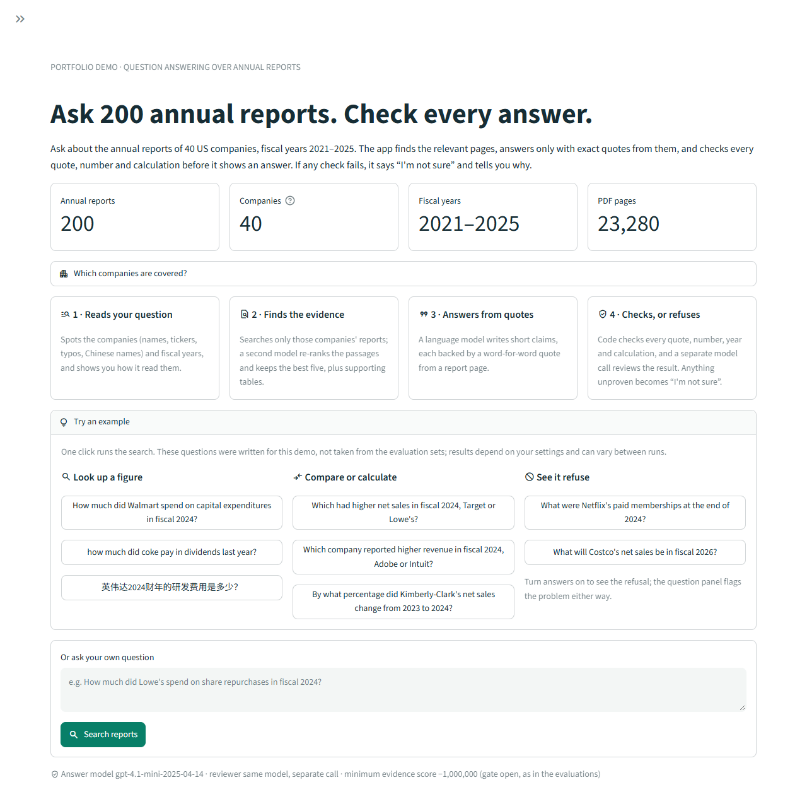

# Financial report Q&A demo

The local Streamlit app searches the annual-report corpus, scopes the search to the companies and periods named in the question, reranks the pooled vector matches to five balanced passages, appends the context extras, and shows their document and PDF-page sources. A configured generation endpoint can produce a cited answer through the confidence, source-binding, reference-validation, grounding and semantic-review checks.



Retrieval works without a generation endpoint. The app has no canned-answer mode. A refused answer displays **"I'm not sure"** with a headline, the step where the checks stopped, what to try next and its reason code, while the retrieved passages remain available for inspection. Retrieved passages are search results; their presence does not mean they support an answer.

## Start the app

Run these commands from the repository root using the project's Python environment:

```powershell
.\.venv\Scripts\python.exe -m pip install -e ".[demo,vectors]"
.\.venv\Scripts\python.exe -m streamlit run streamlit_app.py
```

Open [http://127.0.0.1:8501](http://127.0.0.1:8501). The checked-in Streamlit configuration binds to loopback, uses port 8501, runs headlessly, disables usage telemetry, and disables file watching. Stop the server with Ctrl+C in its launch terminal.

The default inference device is `cpu`. On this project's CUDA-capable machine, select the GPU before starting the server:

```powershell
$env:FINANCE_QA_DEVICE = 'cuda:0'
.\.venv\Scripts\python.exe -m streamlit run streamlit_app.py
```

The device is a server setting. Restart the server to change it; there is no browser control that creates a second set of resident models. CUDA mode requires a working CUDA-enabled PyTorch installation. CPU and CUDA use different inference precision, so a threshold measured with one configuration should not be assumed calibrated for the other.

The first search loads and verifies the indexes and model weights. Later searches reuse those resources. The app uses the locally prepared snapshots and does not download models during a request.

## Required local artifacts

The repository contains code and compact experiment results. Large source and model artifacts are excluded from Git and must already be prepared:

| Artifact | Location |
|---|---|
| Report inventory | `data/manifest.json` |
| Original PDFs | `data/raw/<TICKER>/<TICKER>_FY<YEAR>_annual_report.pdf` |
| Parsed source documents | `data/processed_v2/<TICKER>/<REPORT>/` |
| Table-preserving chunks | `data/experiments/chunking_v2/table_preserving_s512_o50/chunks.jsonl` |
| Flat index, metadata, embedding manifest and vectors | `data/indexes/bge-m3_v2/table_preserving_s512_o50/` |
| SQLite chunk payload store | `data/indexes/bm25_s512_o50_v2/retrieval.sqlite` |
| Pinned encoder and reranker snapshots | `.cache/huggingface/` |

These are the corpus v2 folders, the default; `python scripts/build_corpus.py` builds all of them from the downloaded PDFs and fetches the reranker snapshot. With `FINANCE_QA_CORPUS=v1` the app reads the v1 folders, the same paths without the `_v2` suffix, which Tables A1–A13 were measured on. If the selected corpus is not built, the sidebar says so. For v2 it points to `python scripts/build_corpus.py`; v1 cannot be rebuilt with this checkout (it needs the parser from commit `435b7ae`, Table A14).

The demo uses the vector path; the SQLite store supplies the matching chunk payloads. It does not enable query expansion, hybrid retrieval, or the opt-in comparison decomposition; decomposition exists as `DemoService(decompose_comparisons=True)` but the app does not expose it (Table A11 in [system architecture](system_architecture.md)). See [vector indexing](vector_index.md), [reranking](reranker.md), and [generation safeguards](generation_constraints.md) for the preparation pipeline and artifact contracts.

## Search and inspect evidence

1. Click one of the example questions, or type your own and press **Search reports**. The examples were written for the demo and are not taken from the evaluation sets; the "See it refuse" group shows questions the corpus cannot answer.
2. Read the three cards under the question. **Question read** shows the resolved companies, the period (FY years, the latest report or not stated), the reports searched and any warning, such as a company outside the corpus or a forecast question. **Evidence found** counts the candidates, the reranked best matches and the added context passages. **Answer** shows whether a verified answer, a refusal or no answer was produced.
3. Inspect the evidence on the right. **Passages used** lists each passage with its origin (best match by rank, or added context with the reason it was added), its PDF page, its relevance score and any table-layout warning; **All candidates** holds the full initial candidate list. Check fiscal-year headings, units and whether a passage concerns the whole company or a business segment.
4. Open the public report at the cited PDF page, or preview the page locally. The preview opens under the card that asked for it; for an answer citation it boxes the quoted row or paragraph, from parser coordinates. Page numbers are one-based PDF positions and can differ from printed report page numbers.
5. To request generation, turn on **Generate cited answers** in the sidebar and fill in **Connect a model** and the minimum evidence score under **Safety settings**. After an evidence-only search, **Generate answer from this evidence** answers without searching again. A verified answer lists its claims with source numbers, recomputed calculations, the checks it passed (an open evidence gate is shown as open, never as passed) and its source cards; a refusal shows where the checks stopped and what to try next.

Only the completed result is displayed. A rejected draft is never shown as an answer. A citation includes a source paragraph or table-row locator and its supporting quote; the application supplies the document and page identity.

## Configure generation

The sidebar accepts an API base URL, generator model, password-masked API key, optional reviewer model, completion-token parameter, minimum evidence score and answer time limit. These settings and results belong to the browser session. Editing them does not modify the server's environment or another session's settings. The server's `FINANCE_QA_API_KEY` is never sent to the browser: the key field starts blank, and a blank field uses the server's key, but only with the server's own `FINANCE_QA_BASE_URL`; another endpoint entered in the sidebar needs its own key. A badge at the top of the sidebar says whether answers are off, will refuse until setup is complete, or are ready; a line under the question box repeats that status (the setup problem, or the answer model, reviewer and minimum evidence score in use).

Environment variables can provide the initial settings when launching the server:

| Variable | Meaning and default |
|---|---|
| `FINANCE_QA_DEVICE` | `cpu` by default; set `cuda:0` before launch to select the first GPU. |
| `FINANCE_QA_CORPUS` | Corpus version, `v2` by default (same-line table headers read in column order, [architecture Table A14](system_architecture.md)); `v1` is the corpus behind Tables A1–A13. Restart the server to change it. |
| `FINANCE_QA_BASE_URL` | Compatible API base, normally ending in `/v1`. The client appends `/chat/completions`. Empty means no configured endpoint. |
| `FINANCE_QA_MODEL` | Generator model identifier; empty by default. |
| `FINANCE_QA_API_KEY` | Provider credential. It may be empty for a local endpoint that does not require authentication. |
| `FINANCE_QA_VERIFIER_MODEL` | Review model on the same endpoint; blank uses the generator model in a separate request. |
| `FINANCE_QA_TOKEN_PARAMETER` | `max_completion_tokens` by default; select `max_tokens` if the compatible endpoint requires it. |
| `FINANCE_QA_THRESHOLD` | Explicit finite raw reranker cutoff. Blank leaves generation in refusal-only mode. |
| `FINANCE_QA_DEADLINE_SECONDS` | Positive generation-layer budget; default 30 seconds. |

[`.env.example`](../.env.example) documents these names. **The application does not automatically load `.env` files.** Set variables in the launch environment or enter generation settings in the sidebar. For example:

```powershell
$env:FINANCE_QA_BASE_URL = 'https://your-provider.example/v1'
$env:FINANCE_QA_MODEL = 'your-generator-model'
$env:FINANCE_QA_VERIFIER_MODEL = 'your-review-model'
$env:FINANCE_QA_DEADLINE_SECONDS = '30'
.\.venv\Scripts\python.exe -m streamlit run streamlit_app.py
```

Supply the actual credential and chosen threshold through the sidebar or your launch environment. No provider or model is chosen implicitly. Remote endpoints require HTTPS; local loopback HTTP is supported. The endpoint must accept JSON-mode Chat Completions requests and the selected completion-token parameter.

The threshold compares the highest selected raw reranker logit. It is not a probability of correctness. The historical `6.359375` diagnostic is documented in [generation constraints](generation_constraints.md); the demo does not install it as a default or certify it for this server's configuration. Passing a score threshold still requires source and claim verification. The prompt allows derived values such as margins or growth rates only as application-recomputed calculations over cited operands, and deterministic grounding rejects most figures that do not occur in the citations; it cannot prove that every released number is a quoted one.

The generation deadline starts after retrieval. Checks at stage boundaries discard a late result and prevent later stages, but cannot interrupt an active synchronous API call. Provider socket timeouts are separate. A 30-second generation budget is not an end-to-end response-time guarantee.

## Resource and session behavior

One shared service owns the resident encoder, FAISS index, reranker, and source store. A dedicated worker creates, uses, and closes its SQLite connection and serializes model work. Queries, generated answers, and provider credentials are not stored in that shared resource cache; session settings are supplied for each request.

This design follows Streamlit's requirement that [globally cached resources be thread-safe](https://docs.streamlit.io/develop/api-reference/caching-and-state/st.cache_resource) and its [pattern of keeping Streamlit commands outside custom worker threads](https://docs.streamlit.io/develop/concepts/design/multithreading). It also preserves the existing retrieval engine's SQLite thread ownership. A request may wait for another session's work; this local demo has not been load-tested as a multi-user service.

Source actions resolve documents through the checked report catalog rather than accepting arbitrary filesystem paths. The preview and download are bound to the report identity and local PDF hash. Source passages still need careful interpretation: a verified file or exact quotation does not establish that a claim follows from it.

## Validation scope

The current suite has **634 tests: 633 pass and one Windows symlink-privilege test is skipped**; resolved-path confinement is also covered without needing that privilege. It includes twelve service tests, fourteen source-catalog tests, eighteen tests of the demo's wording and layout rules (`tests/test_demo_presentation.py`) and thirty-one Streamlit AppTest flows. When the demo was first released (commit 6b61b5e), the regression run covered 410 tests (409 passed, the same test skipped) in an isolated snapshot that preserved unrelated workspace edits.

Recorded at commit 6b61b5e, before scoped retrieval and prompt v2 (implementation hashes are in the record): a real Chrome browser exercised resident BGE-M3 and BGE reranker models on the local RTX 4060 GPU, using the existing 200-report corpus. Both Microsoft and NVIDIA queries returned 20 candidates (that commit's global vector Top 20) and five selected passages. The browser displayed a final answer and its cited source through two prescribed localhost responses (one generator call, one reviewer call); no paid or live LLM was used. Opening the cited page did not regenerate the answer. The downloaded Microsoft PDF matched the manifest's SHA256. See [recorded demo checks](../data/evaluation/streamlit_demo_checks.json).

The redesigned demo was also exercised in October 2026 with real models: headless Chrome on the same GPU, corpus v2 and live gpt-4.1-mini calls with the gate open. Each example question was run once: the six lookup, comparison and calculation examples returned verified answers whose figures match the cited filings, and both refusal examples refused ([recorded example run](../data/evaluation/demo_examples_check.json)). The screenshots in [`images/`](images/) were taken the same way after the review fixes. Single runs vary between calls, so the examples can still refuse on another run.

The 6b61b5e browser check used controlled responses, so it established integration and refusal behavior, not generated-answer accuracy or reviewer reliability. Live gpt-4.1-mini answers through `DemoService`, the app's request path, are graded in [live bad cases](live_bad_cases.md) and [system architecture](system_architecture.md) Tables A9–A12 (A13 and A14 replay the same answer stage on `DemoService` search contexts), without independent human review. The single warm browser timing is an interactive smoke measurement, including browser synchronization; it is not a latency benchmark or service-level guarantee.
