# System architecture, module rationale and experiments

This document is the single entry point for how the financial-report QA system is built, why each module was chosen, and what every comparison measured. Detailed per-stage write-ups remain in the linked documents; numbers here are copied from the machine-readable result files named in each row.

The corpus is 200 annual reports (10-K style filings) for 40 US companies, FY2021–FY2025: 23,280 PDF pages, 13,141 detected tables and 56,525 retrieval chunks.

## 1. Architecture

```mermaid
flowchart LR
    subgraph S1["1 · Segmentation"]
        PDF[("200 annual-report PDFs<br/>data/raw")] --> PARSE["Layout-aware parser<br/>PyMuPDF native text + pdfplumber tables<br/>numeric-integrity gate"]
        PARSE --> PAGES[("pages.jsonl / tables.jsonl<br/>page + bbox citations")]
        PAGES --> CHUNK["Table-preserving chunker<br/>512 cl100k tokens, 50 overlap<br/>whole rows, repeated headers"]
    end
    subgraph S2["2 · Indexing"]
        CHUNK --> CHUNKS[("56,525 chunks<br/>chunks.jsonl")]
        CHUNKS --> EMB["BGE-M3 dense encoder<br/>1024-d, 8,192-token limit<br/>company/ticker/FY prefix"]
        EMB --> FAISS[("FAISS IndexFlatIP<br/>exact cosine")]
        CHUNKS --> FTS[("SQLite FTS5<br/>BM25 + payload/citation store")]
    end
    subgraph S3["3 · Retrieval"]
        Q(["User question"]) --> SCOPE["Query scope resolver<br/>companies, aliases, typos, CJK names<br/>explicit / relative / missing periods"]
        SCOPE --> VEC["Scoped exact vector search<br/>~20 candidates split across companies<br/>+ latest-report pool if undated<br/>(global Top-20 if no company)"]
        FAISS --> VEC
        FTS --> VEC
    end
    subgraph S4["4 · Re-ranking"]
        VEC --> RR["BGE reranker v2-m3<br/>cross-encoder raw logits<br/>no truncation (8,192 tokens)"]
        RR --> SEL["Balanced Top-5<br/>per-company quota, cross-year<br/>de-duplication, latest-year slots<br/>+ context extras (table, theme, stitched)"]
    end
    subgraph S5["5 · Generation"]
        SEL --> GATE{"Confidence gate<br/>(explicit threshold)"}
        GATE --> BIND["Source binding<br/>re-derive chunks from parsed source<br/>compact context, budget packing"]
        BIND --> GEN["Generator LLM<br/>claims + exact quotes<br/>application-checked calculations"]
        GEN --> CHECK["Deterministic checks<br/>citation repair → exact quote match<br/>years · numbers · companies grounded"]
        CHECK --> VER["Independent verifier LLM<br/>claim support + answers question"]
        VER --> ANS(["Cited answer<br/>or 'I'm not sure' + reason"])
    end
    subgraph S6["6 · Evaluation"]
        BENCH[("Frozen benchmark<br/>100 Q, dev/test company-disjoint")] -.-> E1["Retrieval metrics<br/>Evidence Recall@K, complete evidence"]
        LIVE[("Live usage pool<br/>50 realistic questions<br/>4 user personas")] -.-> E2["End-to-end grading<br/>+ adversarial re-check<br/>→ bad-case table"]
        CTRL[("Controlled fixtures")] -.-> E3["Safety control flow<br/>fault injection"]
    end
    ANS -.-> E2
    SEL -.-> E1
```



The Streamlit demo ([streamlit_demo.md](streamlit_demo.md)) and [`scripts/run_live_usage.py`](../scripts/run_live_usage.py) both run this exact path through `DemoService`. Every answer is either released with page-level citations that were matched to the original parsed source, or replaced by the public abstention "I'm not sure" plus a machine-readable reason code.

### Request path in code

| Step | Code | What happens |
|---|---|---|
| Scope | [`query_scope.py`](../src/report_search/query_scope.py) | Resolves corpus companies (names, aliases such as "coke", tickers, typos such as "starbuks", Chinese names such as 英伟达), unknown companies (Apple, Tesla), explicit years (FY23, "2021 to 2023", 2025财年), relative periods ("last year", "current", "most recent") and missing periods. Out-of-coverage years and forecast intent become notes for the models. |
| Retrieve | [`scoped_retrieval.py`](../src/report_search/scoped_retrieval.py), [`retrieval.py`](../src/report_search/retrieval.py) | One exact FAISS search per resolved company (max(6, ⌈20/n⌉) candidates each, at most 30 in total), restricted to that company's reports and to the resolved report years when stated or implied. For an undated question, a 4-candidate search restricted to each company's latest report is added. Without a resolved company, the original global vector Top-20 is used. |
| Decompose (optional, off by default) | [`decomposition.py`](../src/report_search/decomposition.py) | For a comparison of two or more resolved companies, `DemoService(decompose_comparisons=True)` gives each company its own sub-question (a deterministic rewrite, or a validated model plan), searches it only in that company's reports and reranks it against its own wording; the Top-5 gives each company an equal share first. The original question is then answered from the combined passages. Measured in Table A11. |
| Rerank and select | [`reranker.py`](../src/report_search/reranker.py), [`scoped_retrieval.py`](../src/report_search/scoped_retrieval.py) | Every pooled candidate is scored by the cross-encoder. The Top-5 reserves floor(5 / companies) slots per compared company (at least one; with six or more companies some get none, which the trace records), skips a passage that repeats one already selected from the same company's other report with identical figures, and for undated questions keeps latest-report slots (two for one company, one per company in a comparison). |
| Context extras | [`scoped_retrieval.py`](../src/report_search/scoped_retrieval.py) | On the scoped path (a resolved company, decomposition off), up to 8 passages (10 for a summary question) are appended after the Top-5 and scored by the reranker:<br>• for non-summary questions, per company, the table among its vector Top-20 whose row labels best match the question (tables with at least three financial-statement row types first, half a step lower when they mention segments), and for a single company the question's best BM25 hit;<br>• for a question that asks for a summary, up to 3 prose neighbours of the selected prose, the most similar to the question, and for a single company two BM25 hits per theme;<br>• the same-table neighbours of a selected table, and the table chunk that directly follows a selected non-table passage on the same or next page.<br>Measured in Tables A12 (v1) and A13 (v3). |
| Gate | [`confidence.py`](../src/report_search/confidence.py) | Always applied and fail-closed: the maximum raw reranker logit must reach an explicitly configured threshold, and with no threshold every request abstains (`unconfigured_threshold`). No default value is installed (see Table A8). |
| Bind | [`evidence_binding.py`](../src/report_search/evidence_binding.py), [`generation.py`](../src/report_search/generation.py) | Re-derives each chunk from the parsed source and checks hashes. The models receive a compact projection: evidence IDs, pages, unit kind (header rows marked) and text, each once. Over the context budget, the lowest-ranked passage that is not a company's or report year's last passage is dropped, repeatedly; if none can be dropped the request abstains (`context_budget_exceeded`), and the gate is rechecked on the passages kept. |
| Generate | [`generation.py`](../src/report_search/generation.py) | Prompt `evidence-bound-claims-v2.3`: one checkable claim per item, verbatim quotes, period and premise rules, derived values only via a `calculation` object, and an explicit result claim for "which is higher" comparisons (v2.2). v2.3 adds a verifier calibration sentence. Tables A9 and A10 were measured with v2.1. Up to 15 passages and 3,072 output tokens. |
| Check | [`answer_verification.py`](../src/report_search/answer_verification.py) | Citation repair re-points a quote to an exact source span: typography (NBSP, ligatures, curly quotes, dot leaders, hyphens, trailing punctuation), a table row quoted with selected cells, an ellipsis inside one unit (the full span is shown), a wrong evidence ID (re-pointed to a unique exact match, first in the cited chunk, then anywhere in the request's sources; a bare figure without letters moves only within its own report), a quote split across adjacent parser fragments (one citation per unit), two quotes of one unit (merged), and as a last resort a near-verbatim quote trimmed to its longest exact block. Then exact reference validation, recomputation of calculations, and grounding of every year, date, number, company and qualifier in the claim (a figure may also equal another claim's verified calculation). Value checks reject a table figure taken from another fiscal year's column and a footnoted row whose unmarked row is in context. At most one corrective retry follows for these mechanical failures. |
| Verify and render | [`generation.py`](../src/report_search/generation.py), [`answer_verification.py`](../src/report_search/answer_verification.py) | A separate model call judges claim support and completeness. For a "which is higher" comparison whose claims give one amount per company but no verdict, the application then appends the result sentence, citing both claims (Table A13). Rendering takes page numbers and locators from verified metadata, never from the model. |

## 2. Why each module was selected

### 2.1 Segmentation: geometric parser and table-preserving 512/50 chunks

- **Transparent geometric parsing instead of a neural layout stack.** DeepDoc-style OCR and table-structure models need trained models and a runtime the project does not ship. The parser keeps DeepDoc's separation of acquisition, layout, tables and provenance with PyMuPDF native text and pdfplumber tables ([deepdoc_reference.md](deepdoc_reference.md)). The full run parsed 200/200 reports with zero integrity errors and accounted for all 1,639,474 active native lines (`data/parsed_validation_report.json`). The known cost is no OCR: 324 pages carry sparse-text or encoding warnings.
- **Numeric-integrity gate for tables.** A table is kept as structured rows only if the digit tokens in its cells equal those in the native text; otherwise the original text is used. 12,055 of 13,141 tables passed; 1,086 fall back. The audited Intel FY2024 p65 table ("5533,,110011" instead of "53,101") was contained by this gate ([classic_bad_cases.md](classic_bad_cases.md)).
- **Table-preserving chunks.** Rows are never split, header and unit rows repeat in every table chunk, and unverified tables or failed pages stay whole. A validator checks every source character and table row; all 1,800 document/configuration validations passed.
- **512 tokens / 50 overlap.** Highest BM25 evidence Recall@5 of the nine size/overlap variants (50.00%) and the smallest Top-5 context (2,039.5 tokens). Larger chunks lost 12.5–22.5 pp; more overlap added chunks without gain (Table A1).

### 2.2 Indexing: BGE-M3, exact FAISS Flat and SQLite FTS5

- **BGE-M3 rather than bge-large-en-v1.5.** Keeping tables whole requires a long-context encoder. A tokenizer preflight over all 56,525 rendered chunks found 0 overflows for BGE-M3 (max 7,921 of 8,192 tokens) and 14,704 overflows (26.01%) for bge-large's 512-token limit, so bge-large could not embed the corpus without truncation (Table A2). BGE-M3 is also multilingual, which the live pool exercised with Chinese questions.
- **Company/ticker/fiscal-year prefix** on each passage gives dense retrieval document identity in a corpus of 40 similar 10-Ks without changing source text.
- **Exact Flat index.** At 56,525 × 1,024 dimensions, exact search costs about 22 ms per query. IVF matched Flat up to k=20 and HNSW lost 5.0–6.7% of neighbours, which lowered evidence recall at @10–@50 (Table A3). Exact search keeps approximation loss out of every downstream comparison, and only Flat supports the exact per-company filtered search used by scoped retrieval.
- **SQLite FTS5.** A dependency-free lexical baseline and the single payload/citation store that dense hits resolve against.

### 2.3 Retrieval: dense vector search, scoped by the question

- **Dense over BM25.** On the 50 held-out test questions, dense Evidence Recall@5 was 37.33% versus 11.33% for BM25, and dense led at every cutoff (Table A4).
- **Hybrid was not deployed.** The dev-selected hybrid (α = 0.5) led only at @3 (+5.00 pp) and @5 (+3.00 pp, paired 95% CI −4.33 to +11.33) on test, and trailed vector at @10–@50 and on comparative questions. The reranker consumes 20 candidates, and at depth 20 vector beat hybrid on both test (60.00% vs 56.67%) and dev (71.33% vs 69.33%).
- **Query expansion stays off.** Financial synonym hints lowered dev Evidence Recall@20 by 2.00 pp against plain BM25 fusion and displaced exact rows in the audited NVIDIA probe (Table A5).
- **Comparison decomposition is opt-in.** Per-company sub-questions raised comparative Evidence Recall@5 from 31.67% to 53.33% (rule rewrite, CI +8.3 to +35.0 pp). The full-accuracy gain on the benchmark was not statistically clear, and the 12 live comparisons did not improve (Table A11), so decomposition is not the default.
- **Scoped retrieval.** The live bad-case audit showed that a single global Top-20 lets one company of a comparison crowd out the other ("coke vs pepsi", "HD or Lowe's", "qualcomm vs broadcom"). It also lets relative or undated questions ("last year", "current credit rating") be answered from stale reports. Scoping uses only the question and the inventory, never benchmark labels. Its effect on the frozen benchmark is reported in Table A6, and its effect on live questions in [live_bad_cases.md](live_bad_cases.md).

### 2.4 Re-ranking: BGE reranker v2-m3 on the vector Top-20

- **Cross-encoder reranking** raised test Evidence Recall@5 from 37.33% to 48.00% (+10.67 pp, CI +3.67 to +18.34; 11 questions improved, 2 worsened) and complete-evidence@5 from 26% to 36% with no question worsened (Table A7).
- **No truncation.** 1,062 of 2,000 benchmark pairs exceed 512 tokens, so the default length would cut table rows; the adapter uses the 8,192-token limit and rejects any overflow. The maximum observed pair was 1,566 tokens.
- **Cost.** 388.8 ms median added GPU scoring per 20-candidate test query (RTX 4060 laptop, FP16), plus about 17–18 s one-time model load.
- **Balanced selection.** Raw reranker order is kept, except that comparisons reserve slots per company, cross-year near-duplicates are skipped, and undated questions keep the latest report.
- **Context extras after the Top-5.** The reranker demotes statement tables: it ranks a gold table above narrative prose in only 24.2% of pairs, against 66.7% for vector order. A few structure-aware passages are therefore appended after the Top-5 rather than replacing it. Benchmark EvR rose from 57.50% to 75.83%, and answer accuracy from 50% to 64%, for about 44% more tokens (Table A12).

### 2.5 Generation: evidence-bound claims with deterministic and model checks

- **Claims with verbatim quotes, not free text.** Exact quote matching proves that the cited passage exists, and page numbers come from verified metadata, so a model cannot invent a citation.
- **A separate verifier call** judges whether each quote supports the whole claim (entity, period, metric, basis, units) and whether the question is fully answered. The controlled checks showed the control flow working with prescribed verdicts (11/11, recorded at commit 873038a, before the live-audit changes; see [generation_constraints.md](generation_constraints.md)); the live audit measures it with a real model.
- **Deterministic grounding.** The live audit found the verifier approving a historical FY2025 figure relabelled as a "2027 projection", and a claim with an uncited figure and a computed growth rate. Every year, number and company in a claim, including a company outside the corpus, must occur in its cited passages before the verifier is called.
- **Application-checked calculations.** Margins and growth rates were refused by design before the live audit. The generator may cite operand cells and an expression; the application recomputes the result and renders the formula.
- **Compact context.** Serializing each evidence unit three times with its full citation object turned about 10 kB of evidence into 100–400 kB and refused 8 of 50 live questions. The models receive each unit once; provenance stays local for validation and rendering.
- **No default gate threshold.** The gate is always applied and refuses until a threshold is configured. The dev-calibrated raw-logit threshold 6.359375 reached 90.91% complete-evidence precision on dev but 73.33% on test, and refused 7 of 18 complete-evidence test questions (Table A8). On the live pool it would have kept only 4 of the 25 correct or acceptable answers released in the final run, while also blocking all 5 bad released answers ([live_bad_cases.md](live_bad_cases.md)). Raw logits are not calibrated probabilities, so no default threshold is installed.

### 2.6 Evaluation: three complementary evidence sources

| Evaluation | What it measures | What it cannot measure |
|---|---|---|
| Frozen 100-question benchmark ([retrieval_experiment.md](retrieval_experiment.md)): 40 factual, 30 comparative, 30 summary; dev/test company-disjoint; 190 source-anchored evidence units | Source selection: Evidence/Document Recall@K, complete evidence, precision@5, context tokens; end-to-end answer accuracy, agent-graded against the gold answers (Tables A10, A11) | Correct refusals (every question is answerable); labels and grades lack independent human review, and labels are non-exhaustive |
| Live usage pool ([live_bad_cases.md](live_bad_cases.md)): 50 realistic questions from four user personas, gold answers verified against parsed sources | End-to-end behaviour of the real product path with a live model: correct answers, false refusals, wrong or unsafe answers, by failure stage | Population rates (50 hand-designed questions); gold answers lack independent human review |
| Controlled fixtures ([classic_bad_cases.md](classic_bad_cases.md), [generation_constraints.md](generation_constraints.md)) | That each safety branch refuses injected faults with the expected reason code | Real model error frequencies |

## 3. Experiment table

All retrieval metrics are macro averages per question. Evidence Recall@K is the fraction of gold source units fully covered by the first K chunks. Benchmark labels are agent-authored and source-checked without independent human review. "Selected" marks the production choice.

### A1. Segmentation: chunk size × overlap (BM25, 40-question pilot, 48 gold units)

Source: [chunking_experiment.md](chunking_experiment.md) publishes the method, chunk counts, Recall@5, deltas and Top-5 tokens; the per-type recall and Δ intervals come from `data/experiments/chunking/comparison.json`, which is generated locally and gitignored.

| Variant | Chunks | Recall@5 | Prose / table Recall@5 | Δ vs 512/50 (95% CI) | Top-5 tokens |
|---|---:|---:|---:|---:|---:|
| **512 / 50 (selected)** | 56,525 | **50.00%** | 65.0% / 35.0% | — | 2,039.5 |
| 512 / 100 | 59,720 | 46.25% | 62.5% / 30.0% | −3.75 pp (−12.5, +2.5) | 2,075.1 |
| 512 / 200 | 69,498 | 46.25% | 57.5% / 35.0% | −3.75 pp (−12.5, +2.5) | 2,141.825 |
| 1024 / 50 | 38,311 | 35.00% | 40.0% / 30.0% | −15.0 pp (−32.5, +2.5) | 3,625.825 |
| 1024 / 100 | 38,858 | 32.50% | 35.0% / 30.0% | −17.5 pp (−35.0, −2.5) | 3,724.5 |
| 1024 / 200 | 40,188 | 37.50% | 55.0% / 20.0% | −12.5 pp (−27.5, +0.06) | 3,799.875 |
| 2048 / 50 | 31,278 | 30.00% | 40.0% / 20.0% | −20.0 pp (−35.0, −7.5) | 6,271.575 |
| 2048 / 100 | 31,359 | 30.00% | 40.0% / 20.0% | −20.0 pp (−35.0, −7.5) | 6,209.65 |
| 2048 / 200 | 31,548 | 27.50% | 40.0% / 15.0% | −22.5 pp (−37.5, −7.5) | 6,457.15 |

All nine variants are table-preserving; no naive splitter was measured. The pilot is small (baseline CI 35–65%) and was scored with BM25 before the dense retriever existed.

### A2. Indexing: embedding-model feasibility (all 56,525 rendered chunks)

Source: `docs/vector_preflight_results.json` (token audit) and `docs/vector_index_results.json` (build time); details in [vector_index.md](vector_index.md).

| Model | Token limit | Mean / max tokens | Inputs over limit | Outcome |
|---|---:|---:|---:|---|
| **BAAI/bge-m3 (selected)** | 8,192 | 431.1 / 7,921 | 0 (0.00%) | Embedded losslessly: 1,437.3 s summed committed shard time (token checks, encoding, writes, first-shard model load) |
| BAAI/bge-large-en-v1.5 | 512 | 381.2 / 5,230 | 14,704 (26.01%) | Rejected: truncation would cut 14,704 inputs (14,044 prose, 306 table, 95 table-fallback, 259 page-fallback), breaking the no-truncation guarantee |

This is a feasibility comparison; no retrieval-quality comparison with bge-large exists.

### A3. Indexing: FAISS index type (50 test questions, CPU, 4 threads)

Source: `data/evaluation/faiss_comparison_results.json`; details in [faiss_index_comparison.md](faiss_index_comparison.md).

| Index | ANN Recall@10 / @50 vs exact | Median / p95 search | RSS increase on load | Evidence Recall@10 / @20 / @50 |
|---|---:|---:|---:|---:|
| **Flat IP (selected)** | 100% / 100% | 22.00 / 26.76 ms | 231.7 MB | 50.00% / 60.00% / 77.67% |
| IVF Flat (nlist 256, nprobe 16) | 100% / 99.92% | 0.67 / 1.10 ms | 233.6 MB | 50.00% / 60.00% / 77.67% |
| HNSW Flat (M 32, efSearch 64) | 95.00% / 93.68% | 0.10 / 0.28 ms | 247.2 MB | 48.00% / 57.00% / 72.67% |

### A4. Retrieval: dense vs BM25 vs weighted hybrid (frozen benchmark)

Source: `data/evaluation/recall_at_k_results.json`; details in [recall_at_k_comparison.md](recall_at_k_comparison.md) and [retrieval_comparison.md](retrieval_comparison.md).

| Split · method | EvR@3 | EvR@5 | EvR@10 | EvR@20 | EvR@50 | DocR@5 | Complete evidence@5 |
|---|---:|---:|---:|---:|---:|---:|---:|
| Test · **vector (selected)** | 26.00% | 37.33% | 50.00% | 60.00% | 77.67% | 87.00% | 26.00% |
| Test · BM25 | 10.67% | 11.33% | 15.33% | 28.67% | 40.00% | 73.00% | 10.00% |
| Test · hybrid α=0.5 | 31.00% | 40.33% | 45.33% | 56.67% | 75.00% | 86.00% | 32.00% |
| Dev · vector | 30.00% | 38.67% | 62.33% | 71.33% | 86.33% | 85.00% | 28.00% |
| Dev · BM25 | 20.00% | 23.33% | 33.33% | 41.33% | 56.33% | 71.00% | 18.00% |
| Dev · hybrid α=0.5 | 41.33% | 46.67% | 56.00% | 69.33% | 84.67% | 91.00% | 34.00% |

Hybrid weight selection on dev (EvR@5): α=0 (BM25) 23.33%, 0.25 32.00%, **0.5 46.67%**, 0.75 45.33%, 1.0 (vector) 38.67%. Test paired difference at @5: hybrid − vector +3.00 pp (CI −4.33, +11.33); hybrid − BM25 +29.00 pp (CI +18.33, +40.67). By test category at @5, vector / BM25 / hybrid: factual 65.00% / 25.00% / 80.00%, comparative 20.00% / 0.00% / 10.00%, summary 17.78% / 4.44% / 17.78%.

### A5. Retrieval: candidate-pool expansion (dev only, before reranking)

Source: `data/evaluation/query_expansion_results.json` and `data/evaluation/bad_case_retrieval_results.json`.

| Pool (≤20 candidates) | EvR@5 prefix | EvR@20 | Complete evidence@20 | Median assembly |
|---|---:|---:|---:|---:|
| **Original vector Top-20 (selected for unscoped questions)** | 38.67% | 71.33% | 52.00% | — |
| Vector Top-20 filtered to requested companies | 52.33% | 71.33% | 52.00% | 0.9 ms |
| + original-query BM25, RRF fusion | 51.00% | 74.67% | 56.00% | 224.7 ms |
| + up to 2 financial-hint BM25 queries | 49.00% | 72.67% | 54.00% | 378.8 ms |

Hints − plain fusion: −2.00 pp EvR@20 (CI −7.00, +2.00; 1 improved, 2 worsened). BM25 fusion − filtered vector: +3.33 pp (CI −3.33, +10.00). In four reranked diagnostic probes, every expanded or fused NVIDIA pool pushed the exact cash-flow row out of the final Top-5 (Recall@5 1 → 0).

### A6. Retrieval + re-ranking: global vs scoped pools (frozen benchmark, same reranker)

Source: `data/evaluation/scoped_retrieval_results.json`, produced by [`scripts/evaluate_scoped_retrieval.py`](../scripts/evaluate_scoped_retrieval.py). Both paths share one query embedding and the same pinned reranker in one process; nothing was tuned on these labels.

| Split · approach | EvR@5 | Complete evidence@5 | DocR@5 | Pool evidence recall | Context tokens@5 |
|---|---:|---:|---:|---:|---:|
| Dev · global vector Top-20 → rerank Top-5 | 57.33% | 40.00% | 90.00% | 71.33% (20) | 2,118.2 |
| Dev · **scoped pools → rerank → balanced Top-5 (selected)** | **63.67%** | **50.00%** | **100.00%** | **90.33%** (20) | 2,159.7 |
| Test · global vector Top-20 → rerank Top-5 | 48.00% | 36.00% | 90.00% | 60.00% (20) | 2,030.6 |
| Test · **scoped pools → rerank → balanced Top-5 (selected)** | **51.33%** | **38.00%** | **100.00%** | **73.67%** (20) | 2,070.4 |

Paired scoped − global: dev EvR@5 +6.33 pp (CI −3.00, +16.00; 11 improved / 34 unchanged / 5 worsened), complete evidence@5 +10.0 pp (CI 0.0, +20.0); test EvR@5 +3.33 pp (CI −4.00, +10.67; 7 / 40 / 3), complete evidence@5 +2.0 pp (CI −6.0, +10.0). By test category, EvR@5 global → scoped: factual 75.00% → 80.00%, comparative 33.33% → 33.33%, summary 26.67% → 31.11%; dev comparative fell 33.33% → 30.00%. The global path reproduces the published reranker numbers exactly (dev 57.33%, test 48.00%), and the scope resolver named the gold companies on all 100 questions.

Reading: scoping reliably fixes *which reports* are searched (DocR@5 100% on both splits; the Top-20 pool's evidence coverage rises 13.7–19.0 pp), but the Top-5 gain is within noise because the reranker still has to pick the labelled passage inside each company's report; of the five dev questions that worsened, four are comparisons: in dev-022, dev-027 and dev-028 the other company's quota slots displaced a labelled row that had ranked fourth or fifth globally, and in dev-030 the deeper Amazon pool contributed two higher-reranked but unlabelled Amazon passages that displaced Amazon's labelled row; the fifth (dev-015) is factual. These benchmark questions all name their company and year, so this table measures the explicit-scope case only; relative and undated questions are measured on the live pool (A9).

### A7. Re-ranking: vector Top-5 vs vector Top-20 → BGE reranker → Top-5

Source: `data/evaluation/reranker_results.json`; details in [reranker_comparison.md](reranker_comparison.md).

| Split · approach | EvR@5 | Complete evidence@5 | Precision@5 | Evidence acc@1 | DocR@5 | Context tokens |
|---|---:|---:|---:|---:|---:|---:|
| Test · vector Top-5 | 37.33% | 26.00% | 10.40% | 14.00% | 87.00% | 1,806.8 |
| Test · **reranked Top-5 (selected)** | **48.00%** | **36.00%** | 14.00% | 26.00% | 90.00% | 2,030.6 |
| Test · Top-20 pool (ceiling) | 60.00% @20 | 44.00% @20 | — | — | 96.00% @20 | 6,952.2 |
| Dev · vector Top-5 | 38.67% | 28.00% | 11.20% | 16.00% | 85.00% | — |
| Dev · reranked Top-5 | 57.33% | 40.00% | 17.20% | 20.00% | 90.00% | — |

Test paired deltas (reranked − direct): EvR@5 +10.67 pp (CI +3.67, +18.34; 11/37/2 improved/unchanged/worsened), complete evidence@5 +10.0 pp (CI +2.0, +18.0; 5/45/0), evidence accuracy@1 +12.0 pp (CI −2.0, +26.0). Test by category, EvR@5 direct → reranked: factual 65.00% → 75.00%, comparative 20.00% → 33.33%, summary 17.78% → 26.67%. Latency: test median 388.8 ms, p95 546.3 ms added GPU scoring per query.

### A8. Generation: raw reranker-logit confidence gate (dev-calibrated)

Source: `data/evaluation/generation_gate_results.json`; details in [generation_constraints.md](generation_constraints.md).

| Threshold (max Top-5 logit) | Split | Accepted | Coverage | Complete-evidence precision |
|---:|---|---:|---:|---:|
| none | dev / test | 50 / 50 | 100% | 40.00% / 36.00% |
| 5.27734375 | dev | 20 | 40% | 70.00% |
| **6.359375 (diagnostic)** | dev | 11 | 22% | 90.91% (Wilson 62.3–98.4%) |
| 6.359375 | test | 15 | 30% | 73.33% (Wilson 48.0–89.1%); 7 complete-evidence questions refused |
| 6.59375 | dev | 8 | 16% | 100% |

Comparative and summary questions were never accepted at 6.359375 on either split. The live end-to-end effect of this gate is reported in [live_bad_cases.md](live_bad_cases.md).

### A9. End-to-end: live usage pool before and after the bad-case fixes

Source: `data/evaluation/live_bad_case_results.json` (grades in `data/evaluation/live_usage_grades.json`); process and table in [live_bad_cases.md](live_bad_cases.md).

| Run | Answered | Correct | Acceptable | Correct refusals | False refusals | Partially correct | Wrong | Unsafe | Median context chars |
|---|---:|---:|---:|---:|---:|---:|---:|---:|---:|
| Baseline (original demo path, prompt v1) | 21 | 10 | 1 | 6 | 23 | 4 | 5 | 1 | 65,479 |
| **Final (all fixes, prompt v2.1)** | 30 | **21** | **4** | 7 | 13 | 4 | **1** | **0** | **11,708** |

Fifteen baseline bad cases were fixed and none regressed; 18 of 50 remain bad, and the one wrong answer (B12) labels segment figures as company totals and answers the wrong period: neither the qualifier check nor year grounding binds a number to its segment or column year. These results are measured on the same questions that drove the fixes. Details and intermediate runs: [live_bad_cases.md](live_bad_cases.md).

### A10. End-to-end answers on the frozen 100-question benchmark: original vs current pipeline

Source: `data/evaluation/benchmark_e2e_results.json` (grades in `data/evaluation/benchmark_e2e_grades.json`). Both systems answered all 100 benchmark questions live with gpt-4.1-mini, gate open. **Original** is commit 6b61b5e, before the live bad-case fixes: vector Top-20, reranked Top-5, prompt v1. **Current** is the pipeline after the live bad-case fixes, with prompt v2.1 as measured at the time of this run; v2.2 was measured on the comparative questions in Table A11, and the shipped prompt is v2.3 (Table A13). The fixes were designed on the separate live pool, so this benchmark is independent of them. Each question was graded side by side against the gold answer and its evidence, and every grade was re-checked by a second agent. All benchmark questions are answerable, so every refusal counts as a false refusal.

| Split · system | Accuracy (fully correct) | Correct or partial | Answered | Wrong | Gold answer points covered |
|---|---:|---:|---:|---:|---:|
| All 100 · original | 34% | 40% | 48% | 8 | 30.9% |
| All 100 · **current** | **51%** | **60%** | **69%** | 9 | **48.6%** |
| Test 50 · original | 32% | 40% | 54% | 7 | 31.8% |
| Test 50 · **current** | **48%** | **56%** | **64%** | 4 | **44.5%** |
| Factual 40 · original → current | 65% → **90%** | 65% → 90% | 65% → 95% | 0 → 2 | 65.0% → 90.0% |
| Comparative 30 · original → current | 10% → 17% | 17% → 23% | 33% → 37% | 5 → 4 | 18.9% → 26.7% |
| Summary 30 · original → current | 17% → 33% | 30% → 57% | 40% → 67% | 3 → 3 | 27.8% → 52.2% |

Paired accuracy gains:
- **All 100:** +17.0 points (95% CI +8.0 to +26.0; 21 questions improved, 4 worsened). Correct-or-partial rose +20.0 points (CI +9.0 to +31.0).
- **Test:** +16.0 points (CI +6.0 to +26.0).
- **By category:** factual +25.0 points (CI +12.5 to +37.5). Comparative (+6.7, CI −6.7 to +20.0) and summary (+16.7, CI −3.3 to +36.7) are not statistically clear.

Released answers that are fully correct rose from 70.8% to 73.9%. Wrong answers did not fall (8 → 9), because 21 more questions received an answer. The new errors belong to the open failure families of [live_bad_cases.md](live_bad_cases.md):
- a wrong fiscal-year column (dev-017, dev-034);
- a segment subtotal given as the company total (dev-003, dev-021);
- net income given as revenue (dev-022);
- misattributed summary themes.

The original system mostly refused: quote mismatches 20, generator refusals 19, context overflow 8.

### A11. Comparison decomposition: per-company sub-questions (30 comparative benchmark questions, 12 live comparisons)

Sources:
- retrieval: `data/evaluation/decomposition_results.json` (model plan v1: `decomposition_results_v1.json`), from [`scripts/evaluate_decomposition.py`](../scripts/evaluate_decomposition.py);
- benchmark answers: `data/evaluation/decomposition_e2e_results.json`, grades in `decomposition_e2e_grades.json`, from [`scripts/summarize_decomposition_e2e.py`](../scripts/summarize_decomposition_e2e.py);
- live answers: `data/evaluation/live_decomposition_grades.json`.

Code: [`decomposition.py`](../src/report_search/decomposition.py). It is opt-in through `DemoService(decompose_comparisons=True)` or `run_live_usage.py --decompose rule|model`.

**How it works.** When a question resolves to a comparison of two or more companies, each company gets its own sub-question, from one of two sources:
- **rule:** the question with the other companies' names removed, prefixed with the company name;
- **model:** a gpt-4.1-mini plan, validated before use. Each sub-question may name only its own company and may not add years, with at most three per company. An invalid plan falls back to the rule.

Each sub-question is embedded, searched only in its own company's reports (up to 10 candidates) and reranked against its own wording. The Top-5 first gives each company floor(5 / companies) slots, then fills the rest round-robin. The original question is then answered from the combined passages, with the generation checks unchanged.

**Retrieval** (same models, corpus and 5-passage budget):

| Approach | EvR@5 all / dev / test | Complete evidence@5 | Pool evidence recall |
|---|---:|---:|---:|
| Scoped single query (default) | 31.67% / 30.00% / 33.33% | 13.33% | 80.00% |
| **Rule decomposition** | **53.33%** / 50.00% / **56.67%** | **33.33%** | 75.00% |
| Model decomposition (plan prompt v2) | 46.67% / 60.00% / 33.33% | 23.33% | 91.67% |

Paired differences against scoped:
- **Rule, EvR@5:** +21.67 pp (CI +8.33 to +35.0; 13 questions improved, 15 unchanged, 2 worsened). Test alone: +23.33 pp (CI +6.67 to +36.67).
- **Rule, complete evidence:** +20.0 pp (CI +3.3 to +36.7).
- **Model, EvR@5:** +15.0 pp (CI 0.0 to +30.0), with a test difference of +0.0.

The rule variant was fixed before any benchmark run. The model variant was not held out. Its v1 plan added sub-questions for fiscal-year-end dates, and those took Top-5 slots. The plan rule against them and the company-first quota were added after test results were seen, and test EvR@5 stayed at 33.33%. Model plans are also sampled: a second run with the same v2 prompt reached 46.67% on test (the plans of the end-to-end `decomposed_model` run, `decomposition_e2e_results.json`, `summary.test.decomposed_model`).

Cost (median search time per request with the models already loaded, `decomposition_e2e_results.json`, `systems.<name>.median_timings_ms`): the rule rewrite added no measurable latency (540.0 ms vs 541.7 ms scoped). The model plan raised it to 1,623.8 ms, of which the plan call took 962.2 ms.

**End-to-end answers on the 30 comparative benchmark questions.** Every system answered live with gpt-4.1-mini, gate open. Within each prompt version, the three systems were graded blind side by side: labels were shuffled per question and the decomposition trace was removed. A skeptic agent re-checked every grade.

| System | Accuracy (fully correct) | Correct or partial | Answered | Wrong | Gold answer points | EvR@5 |
|---|---:|---:|---:|---:|---:|---:|
| Scoped, prompt v2.1 (Table A10 current) | 16.7% | 23.3% | 36.7% | 4 | 26.7% | 31.67% |
| Rule decomposition, v2.1 | 13.3% | 53.3% | 60.0% | 2 | 43.3% | 53.33% |
| Model decomposition, v2.1 | 23.3% | 53.3% | 63.3% | 3 | 47.8% | 53.33% |
| Scoped, prompt v2.2 | 20.0% | 26.7% | 40.0% | 4 | 31.1% | 31.67% |
| Rule decomposition, v2.2 | 26.7% | 53.3% | 66.7% | 4 | 48.9% | 53.33% |
| Model decomposition, v2.2 | **30.0%** | **56.7%** | 63.3% | 2 | **52.2%** | 50.00% |

Paired differences against scoped v2.1:
- **Correct-or-partial:** +30.0 pp (CI +10.0 to +50.0) for rule v2.1, model v2.1 and rule v2.2; +33.3 pp (CI +10.0 to +56.7) for model v2.2.
- **Accuracy, rule v2.2:** +10.0 pp (CI −3.3 to +23.4). Dev: +26.7 pp (CI +6.7 to +46.7). Test: −6.7 pp.
- **Accuracy, model v2.2:** +13.3 pp (CI −3.3 to +30.0). Test: +6.7 pp.

**The 12 live comparison questions (B01–B12).** These are harder than the benchmark comparisons: margins, multi-year growth, and segment versus company scope. The four systems were graded blind together:

| System | Correct | Partial | Wrong | False refusal |
|---|---:|---:|---:|---:|
| Scoped, v2.1 (final live configuration) | 1 | 4 | 1 | 6 |
| Rule decomposition, v2.1 | 2 | 2 | 1 | 7 |
| Scoped, v2.2 | 2 | 2 | 0 | 8 |
| Rule decomposition, v2.2 | 0 | 1 | 0 | 11 |

B05 under scoped v2.1 is graded partial here (no explicit verdict) but correct in Table A9. This shows the grader variance between separate grading passes.

**Reading:**
1. **Decomposition reduces the targeted retrieval failure.** With it, the second company's labelled rows reach the Top-5 more often (EvR@5 31.67% → 53.33%). Against the scoped path under the same prompt, the system answers 60–67% of comparisons instead of 37–40%, and covers 1.6 to 1.8 times as many gold answer points (43–52% vs 27–31%).
2. **Under v2.1, full accuracy did not clearly rise** (rule −3.3 pp, CI −16.7 to +10.0; model +6.7 pp, CI −10.0 to +26.7). Most new answers listed both figures without saying which was higher, and the verifier accepted them as complete. Prompt v2.2 (rule 7) asks for a result claim, for example "Sample Inc's FY2030 operating income of $1,234 million was higher than Example Corp's $987 million". With v2.2, accuracy reached 27–30% against 17%. The gain comes from dev and is not statistically clear. On test, whose questions also require the fiscal year-end difference, answers still often omit the verdict.
3. **On the live comparisons, decomposition did not help.** Rule v2.2 refused 11 of 12. The refusals were mostly mechanical generation failures that varied between runs: quote mismatches, schema errors and calculation operands. Rule v2.1 added a wrong answer: B07 gave a regional subtotal of Caterpillar's machinery, energy and transportation (ME&T) sales as the company total.
4. **Decision.** Decomposition stays off by default. Prompt v2.2 is kept: its new rule applies only to comparisons, and on the scoped path it changed two benchmark grades (dev-032 partial → correct, test-030 false refusal → partial) and added no wrong answers (live: correct 1 → 2, wrong 1 → 0, refusals 6 → 8). Factual and summary questions were not re-run with v2.2.
5. **Integrity.** Prompt v2.2 was written after seeing the v2.1 grades on these same questions. Only the rule-decomposition retrieval comparison is a pre-registered result.

### A12. Context extras: passages appended after the reranked Top-5 (benchmark and live pool)

Source: `data/evaluation/context_extras_results.json` (grades included). Code: `context_extras` in [`scoped_retrieval.py`](../src/report_search/scoped_retrieval.py), called by `DemoService` after the balanced Top-5. Design: [recall roadmap](recall_roadmap.md), quick wins Q1–Q3.

**Why.** A diagnosis of every lost evidence unit on the benchmark showed that most loss happens after retrieval:
- Of the 42.5 missing points of EvR@5, 24.5 were lost between the 20-candidate pool and the Top-5.
- The reranker ranks a gold statement table above narrative prose in only 24.2% of pairs, against 66.7% for plain vector order.
- One blended summary query drops whole themes.
- A table's continuation or its statement title often sits in the neighbouring chunk.

**What is added.** The Top-5 is unchanged. Up to 8 passages are appended, chosen from the question, the selected passages and new scoped searches of the same indexes. No hand-written lexicon or gold labels are used:
- **Row-label table** (non-summary questions): per company, the table among its vector Top-20 whose first-column row labels best overlap the question's content words.
- **Summary themes** (single-company questions containing "summary" or "summarize"): one FTS5 BM25 hit per theme the question enumerates.
- **Stitching:** the same-`table_id` neighbours of each selected table, and the table that directly follows a selected non-table chunk on the same or next page.

The extras are scored by the reranker, so the confidence gate still sees every passage, and the answer-stage passage limit rose from 5 to 13. The design-phase prototype also used a metric lexicon and an Item 1A section filter. They were left out: the lexicon was partly written from live failures, and the filter added about 1 point of recall for about 25 more lines.

**Method.** Both systems answered all 100 benchmark and 50 live questions live: gpt-4.1-mini generator and verifier, prompt v2.2, gate open, one run each.
- **Base** is commit 7234349.
- **Extras** is the same code plus `context_extras`.
- **Grading:** blind A/B. Labels were shuffled per question, one grader handled each batch of 10 questions, and a skeptic re-checked every grade.
- **Retrieval scores:** strict scores come from the repo judge; eq is the design-phase equivalence judge (table units only).

**Retrieval** (macro EvR at the delivered context; the reranked Top-5 alone is unchanged):

| Split · group | Strict, base → extras | Eq, base → extras | Passages | Tokens |
|---|---:|---:|---:|---:|
| All 100 | 57.50% → **75.83%** | 70.00% → **86.83%** | 5 → 7.57 | 2,115 → 3,046 |
| Dev 50 | 63.67% → 81.00% | 75.67% → 92.00% | 5 → 7.38 | 2,160 → 3,028 |
| Test 50 | 51.33% → **70.67%** | 64.33% → 81.67% | 5 → 7.76 | 2,070 → 3,063 |
| Factual 40 | 80.00% → 87.50% | 90.00% → 90.00% | 5 → 7.15 | 2,098 → 2,794 |
| Comparative 30 | 31.67% → 61.67% | 60.00% → 95.00% | 5 → 8.87 | 1,822 → 3,157 |
| Summary 30 | 53.33% → 74.44% | 53.33% → 74.44% | 5 → 6.83 | 2,430 → 3,269 |

No evidence unit present in the base context was lost. On the live pool, 58 answer facts across 20 cases were checked with model-free text predicates written during the diagnosis (in-sample). The delivered context held 32 of them before and 47 after, and cases with every fact present rose from 6 to 10. Median added search time was 108 ms on the benchmark and 51 ms on the live pool (57 ms over the 48 scoped questions; the 2 global-path questions add none). That covers one Top-20 vector search per company for non-summary questions, one BM25 query per theme for summary questions, neighbour lookups, and reranking 2.6 (benchmark) or 1.8 (live) extra passages on average.

**End-to-end answers on the benchmark:**

| Group | Accuracy (fully correct) | Correct or partial | Answered | Wrong | Gold answer points |
|---|---:|---:|---:|---:|---:|
| All 100 | 50% → **64%** | 67% → 81% | 75% → 84% | 8 → 3 | 52.3% → 69.5% |
| Dev 50 | 56% → 72% | 66% → 84% | 78% → 88% | 6 → 2 | 57.3% → 74.5% |
| Test 50 | 44% → **56%** | 68% → 78% | 72% → 80% | 2 → 1 | 47.3% → 64.5% |
| Factual 40 | 92% → 92% | 92% → 92% | 95% → 95% | 1 → 1 | 92.5% → 92.5% |
| Comparative 30 | 7% → 30% | 27% → 70% | 47% → 77% | 6 → 2 | 27.8% → 58.9% |
| Summary 30 | 37% → 60% | 73% → 77% | 77% → 77% | 1 → 0 | 58.9% → 70.0% |

The base configuration is the same code as A11's "Scoped, prompt v2.2". A11's separate grading pass scored its comparative accuracy at 20% (6 of 30), against 7% (2 of 30) here, with correct-or-partial at 26.7% in both. Compare systems only within one grading pass; all differences below are within-pass.

In the extras run, all 12 partially correct comparative answers omit which company is higher.

Paired accuracy differences, extras minus base:
- **All:** +14.0 points (95% CI +7.0 to +22.0; 15 questions improved, 84 unchanged, 1 worsened).
- **Test:** +12.0 (CI +4.0 to +22.0; 6 improved, 0 worsened).
- **Comparative:** +23.3 (CI +10.0 to +40.0).
- **Summary:** +23.3 (CI +6.7 to +40.0).
- **Released answers:** fully correct rose from 66.7% to 76.2%.

The one worsened question (dev-047) received the same five passages in both runs, so it reflects model sampling. All three remaining wrong answers appear in both systems:
- dev-017 and test-028 use a different fiscal-year column;
- dev-021 gives a segment total as the company figure.

**Live pool (50 questions):**

| System | Good outcomes | Correct | Acceptable clarification | Correct refusal | Partially correct | Wrong | False refusal |
|---|---:|---:|---:|---:|---:|---:|---:|
| Base | 32 | 22 | 3 | 7 | 3 | 2 | 13 |
| Extras | 34 | 24 | 3 | 7 | 6 | 3 | 7 |

Good outcomes rose by 2 (+4.0 points, CI −4.0 to +12.0; 3 cases improved, 1 worsened), which is not statistically clear. The extra evidence mostly turned false refusals into partial answers:
- **Became correct because of an extra:** A08 and B02, where the extra supplied the missing row.
- **Became partial:** B06, B07, B09 and C01.
- **Became correct without the extras:** D09. Its base refusal was a verifier error on the same evidence, the mirror image of A11 below.

Two cases regressed:
- **A03** became wrong after the model called a correctly quoted pre-split figure an error.
- **A11** abstained after the verifier rejected a correct capex claim.

The other two wrong answers differ:
- **A06** is a generation error with the right evidence in context: the p68 GAAP row was present, but the model chose a non-GAAP p52 row.
- **B12** did not have Kraft Heinz's consolidated FY2021 net sales in context. A row-label extra added a FY2021 segment table (18,604), and the model took it as the company base. This is the segment-table risk the roadmap flagged for the table slot.

**Reading.**
- Appending these passages recovered 18.3 of the 42.5 missing EvR points, from reranker drops and pool misses alike.
- No equal-size control (reranked Top-8) was run. The design-phase Monte Carlo estimate for it was 69.0% (bounds 59.0–79.5) at a similar token count, so how much of the gain comes from structure rather than from more passages is not settled.
- On the benchmark this translates into answers: comparative and summary accuracy each rose by about 23 points, and wrong answers fell from 8 to 3.
- The cost is about 44% more context tokens and about 0.1 s of search time.
- **Remaining wrong answers.** Six answers are still wrong: 3 on the benchmark and 3 on the live pool.
  - Four had the needed figure in context: dev-017, test-028, dev-021 and A06. In dev-017 the passage itself printed the year header in reverse order.
  - Two lacked it: B12 (the consolidated base was missing and an extra supplied a segment table) and A03 (the split note was missing).
- **Summary trigger.** The trigger is a keyword. It fired on 29 of the 30 templated benchmark summary questions but on only 1 of the 50 live questions, so the summary gain may not carry over to other wording.
- These rules were designed after diagnosing failures on both benchmark splits and the live pool, so a fresh held-out question set is still needed to confirm the gain.

### A13. Next-phase directions: comparison verdict, value checks, citation repair, context extras v3

Source: `data/evaluation/next_phase_results.json` (blind grades in `next_phase_grades.json`), produced by [`scripts/summarize_next_phase.py`](../scripts/summarize_next_phase.py). Runs are made with [`scripts/replay_generation.py`](../scripts/replay_generation.py) and graded by [`scripts/autograde_answers.py`](../scripts/autograde_answers.py). Design and diagnosis: [next_phase_plan.md](next_phase_plan.md).

**What changed.** Each change is small and covered by unit tests.

| # | Direction | Change |
|---|---|---|
| 1 | Comparison verdict | `comparison_verdict` (`answer_verification.py`) runs after the verifier passes. It fires on a two-company "which is higher/lower" question when each company has exactly one currency or scaled amount and no claim states the comparison. It appends "X reported the higher amount: $A, against $B for Y", citing both claims. |
| 2 | Context extras v2 | Every compared company's name is dropped from the table-slot terms. Singular and plural forms match. Tables with at least three financial-statement row types rank first, and a table that mentions segments ranks half a step lower. One company's question gets its best BM25 hit, and a theme whose top hit is already selected takes the next one. |
| 3 | Citation repair | A final repair pass trims a near-verbatim quote to its longest exact block (at least 70% of the quote and 60 characters). A figure may also equal another claim's verified calculation result. |
| 4 | Value checks | The evidence store binds each table cell to its column year, from the x-position of the year headers. Grounding rejects a figure taken from another year's column (`claim_column_year_mismatch`). It also rejects a footnoted row when the same report's unmarked row is in context (`claim_footnoted_row`). The one corrective retry receives the hint. |
| 5 | Context extras v3 and longer drafts | Summary questions get up to 3 prose neighbours of the selected prose, the most similar to the question, and a single company's summary two BM25 hits per theme: up to 10 extras, and up to 15 passages per answer. The output limit of the generator and verifier calls rises from 2,048 to 3,072 tokens. |
| 6 | Verifier calibration | Prompt `evidence-bound-claims-v2.3` tells the verifier never to mark a sourced figure unsupported because it seems implausible against outside expectations. |

The parser header-order fix (direction 4b) is not part of this table. It needs a full re-parse and re-embed, and is being built as a separate corpus version rather than by overwriting the current corpus.

**Method.** Answer-side arms replay only the answer stage, 5 times per question, on identical recorded contexts (the A12 extras run). The all-six arm retrieves fresh contexts with extras v3 first.
- **Factual and comparative questions:** graded deterministically. The grader matches the gold figures and comparative verdicts. This port agreed with all 230 earlier blind grades it was checked against on fully correct versus not (its prototype agreed with all 310).
- **Summaries and live questions:** graded blind A/B against the gold, and a skeptic re-checked every grade. Summaries use 2 of the 5 repeats; the live pool uses one run per system.
- **Column check version:** all arms ran with the column-year check as first written. Its date-year rule was corrected afterwards (Reading 5); the correction only affects claims whose year comes from a date.

**Answers by arm** (cumulative; 100 benchmark questions × 5 repeats; percentages of repeats):

| Arm | Factual: correct / wrong | Comparative: correct / partial / wrong | Fully correct vs baseline, of 70 (95% CI) | Wrong vs baseline (CI) |
|---|---|---|---:|---:|
| Baseline (commit 435b7ae) | 90.5% / 3.5% | 36.7% / 33.3% / 6.0% | – | – |
| + 4 value checks | 91.5% / 1.0% | 33.3% / 36.0% / 8.0% | −0.6 (−2.6 to +1.2) | −0.4 (−2.8 to +1.4) |
| + 1 comparison verdict | 91.5% / 0.5% | 63.3% / 1.3% / 8.0% | **+8.4 (+4.0 to +13.2)** | −0.6 (−3.2 to +1.2) |
| + 3 citation repair | 91.5% / 0.0% | 66.0% / 2.0% / 5.3% | +9.2 (+5.0 to +14.0) | −1.6 (−4.2 to +0.4) |
| + 6 verifier, 3,072-token drafts | 91.0% / 0.0% | 66.7% / 0.0% / 7.3% | +9.2 (+4.8 to +14.2) | −1.0 (−3.6 to +1.0) |
| **+ 2 and 5: all six, fresh contexts** | **94.0% / 0.0%** | **66.0% / 0.7% / 2.7%** | **+10.2 (+5.2 to +15.8)** | **−2.4 (−5.8 to 0.0)** |

**Summary answers rate:**

| Arm | Baseline | + 4 | + 1 | + 3 | + 6 | All six |
|---|---:|---:|---:|---:|---:|---:|
| Answered | 73.3% | 79.3% | 82.7% | 87.3% | 89.3% | 83.3% |

**Final-context evidence recall** (strict repo judge; the contexts the answers received):
- **Overall:** extras v1 75.83% → extras v3 85.17%.
  - Factual: 87.50% → 92.50%.
  - Comparative: 61.67% → 71.67%.
  - Summary: 74.44% → 88.89%.
- **With the design-phase equivalence judge:** 86.83% → 91.67%.
- **Tokens:** 3,046 → 4,181 per question. Summaries average 6,456, about 2.7 times their 2,430-token Top-5 base, which is above the roadmap's 1.6-times gate.

**Blind grades, baseline vs all six:**
- **Benchmark summaries** (60 graded pairs over 2 repeats):
  - fully correct 41.7% → **51.7%** (+3.0 questions per repeat, CI 0.0 to +6.0; 9 questions improved, 3 worsened);
  - gold answer points 58.9% → 69.4%;
  - wrong 2 → 3;
  - false refusals 17 → 12.
- **Live pool** (50 questions):
  - good outcomes 34 → 34 (CI −5 to +5; 3 improved, 3 worsened);
  - correct 24 → 24;
  - wrong 3 → 2;
  - partially correct 6 → 3;
  - false refusals 7 → 11.

**Reading.**
1. **The comparison verdict is the main gain.** Added after the value checks, it moves the gain from −0.6 to +8.4 of 70 questions, and partial comparative answers nearly disappear (33.3% → 0.7%).
2. **Value checks turn known wrong answers into refusals rather than correct answers.** dev-017, which took the prior-year column, is refused 5 of 5 times in every arm with the checks. test-028 cites its figure from text fragments, where no column year is known, so the check cannot catch it: it was wrong in 17 of the 20 answer-side replays, and correct 5 of 5 times only with the fresh extras v3 contexts.
3. **Extras v3 adds recall.** It adds about +1 fully correct factual or comparative answer and most of the summary-evidence gain. The cost is about twice the summary context.
4. **The live pool did not improve.**
   - Gains: B06 and B07 now state the verdict, and C11 is answered correctly (C07 now answers, partially).
   - Losses: live A12 misreads a figure, B02 became partially correct and D09 is refused. A11 went from a refusal to a wrong answer.
   - Shifts to refusal: B09, C01 and C05 (from partially correct), and A03, A06 and B12 (from wrong).
5. **One false flag was fixed after the runs.** The check as first written ignored a year given only by a date ("December 31, 2019") and fell back to the report year. In live D03 this refused a correct answer; it is the only final refusal caused by a false flag (first-attempt drafts are not stored, so flags that the corrective retry resolved cannot be counted). The check now accepts the date's year, and for a January or February date also the year before, since such a fiscal year can carry the previous year's label (January 1, 2022 closes Cadence's FY2021). An intermediate version accepted the year before for every date; in a replay it let dev-017's prior-year figure through "as of December 31, 2024", so the allowance was limited to those two months. D03 was replayed 3 times with the date fix and answered correctly each time; the lead updated its grade, and the blind grade is kept in the file.
6. **These results are in-sample.** The directions were designed after diagnosing failures on these benchmark and live questions, so a fresh held-out set is still needed.

## 4. Reproduce

From the repository root, with the local corpus, indexes and cached models:

```powershell
# Frozen-benchmark global vs scoped retrieval (GPU)
.\.venv\Scripts\python.exe scripts/evaluate_scoped_retrieval.py --device cuda:0

# Live usage pool through the demo product path (needs FINANCE_QA_* model settings)
.\.venv\Scripts\python.exe scripts/run_live_usage.py --label after_fix --threshold -1000000 `
  --output data/experiments/live_usage/after_fix.jsonl

# End-to-end benchmark answers (Table A10): commit 6b61b5e (original) vs this checkout, all 100 questions.
# This checkout ships prompt v2.3; Table A10's current run used v2.1.
New-Item -ItemType Directory -Force tmp | Out-Null
git archive --format=zip -o tmp/head_code.zip 6b61b5e src
Expand-Archive -Force -Path tmp/head_code.zip -DestinationPath tmp/head_code
.\.venv\Scripts\python.exe scripts/run_live_usage.py --questions data/evaluation/retrieval_questions.json `
  --src tmp/head_code/src --label baseline_head --threshold -1000000 --output data/experiments/benchmark_e2e/baseline.jsonl
.\.venv\Scripts\python.exe scripts/run_live_usage.py --questions data/evaluation/retrieval_questions.json `
  --label current --threshold -1000000 --output data/experiments/benchmark_e2e/current.jsonl
# Grading is agent-performed and recorded in data/evaluation/benchmark_e2e_grades.json.
.\.venv\Scripts\python.exe scripts/summarize_benchmark_e2e.py

# Comparison decomposition (Table A11): retrieval ablation, then comparative answers with rule decomposition
.\.venv\Scripts\python.exe scripts/evaluate_decomposition.py --device cuda:0
.\.venv\Scripts\python.exe scripts/run_live_usage.py --questions data/evaluation/retrieval_questions.json --category comparative `
  --decompose rule --label decomposed_rule_v22 --threshold -1000000 --output data/experiments/benchmark_e2e/decomposed_rule_v22.jsonl
# The summary reads six runs from data/experiments/benchmark_e2e/: current (the A10 run), decomposed_rule and
# decomposed_model (prompt v2.1: commit 960bcc1, run with --src as for the baseline above), and current_v22,
# decomposed_rule_v22 and decomposed_model_v22 (this checkout; --decompose model for the model plan; omit
# --decompose for current_v22).
# Live comparisons (A11, B01-B12): add --ids B01 B02 B03 B04 B05 B06 B07 B08 B09 B10 B11 B12 with
# --label after_fix_v22 (no --decompose) or --decompose rule --label decomposed_rule_v22, writing
# data/experiments/live_usage/<label>.jsonl; decomposed_rule (v2.1) used commit 960bcc1.
# Grading is agent-performed and recorded in data/evaluation/decomposition_e2e_grades.json and
# data/evaluation/live_decomposition_grades.json.
.\.venv\Scripts\python.exe scripts/summarize_decomposition_e2e.py

# Context extras (Table A12): base = commit 7234349 via --src, extras = this checkout; 100 benchmark + 50 live questions
git archive --format=zip -o tmp/extras_base.zip 7234349 src
Expand-Archive -Force -Path tmp/extras_base.zip -DestinationPath tmp/extras_base
.\.venv\Scripts\python.exe scripts/run_live_usage.py --questions data/evaluation/retrieval_questions.json `
  --src tmp/extras_base/src --label bench_base --threshold -1000000 --output data/experiments/context_extras/bench_base.jsonl
.\.venv\Scripts\python.exe scripts/run_live_usage.py --questions data/evaluation/retrieval_questions.json `
  --label bench_new --threshold -1000000 --output data/experiments/context_extras/bench_new.jsonl
# Repeat both without --questions (the live pool) as live_base / live_new. Grading is agent-performed (blind A/B)
# and recorded with the summary in data/evaluation/context_extras_results.json. The retrieval table, live fact
# counts, latency and paired CIs were computed by uncommitted analysis code: strict EvR can be recomputed with
# report_chunker.retrieval.judge_retrieval over each run's search.selected (top_k = len(selected)); the eq judge
# and the live fact predicates are design-phase tools that are not in this repository.

# Next-phase directions (Table A13): replay the answer stage 5x on fixed contexts, grade, summarize
.\.venv\Scripts\python.exe scripts/replay_generation.py --contexts data/experiments/context_extras/bench_new.jsonl `
  --src <code snapshot>/src --label r1_d4 --reps 5 --output data/experiments/next_phase/r1_d4.jsonl
.\.venv\Scripts\python.exe scripts/replay_generation.py --fresh-search --label r5_all --reps 5 `
  --output data/experiments/next_phase/r5_all.jsonl
.\.venv\Scripts\python.exe scripts/autograde_answers.py data/experiments/next_phase/r0_baseline.jsonl `
  data/experiments/next_phase/r5_all.jsonl
# Summary and live grades are agent-performed (blind A/B) and recorded in data/evaluation/next_phase_grades.json.
.\.venv\Scripts\python.exe scripts/summarize_next_phase.py

# Full regression suite
.\.venv\Scripts\python.exe -m unittest discover -s tests
```

`--threshold -1000000` opens the confidence gate so every downstream stage is observable; the decision of the dev-calibrated gate is recorded separately for each question.
